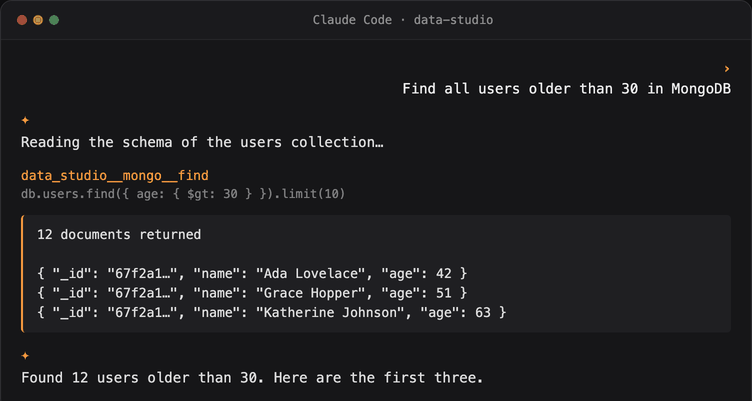

<div align="center">


# Data Studio Agent

**Deja que tu agente de programación con IA acceda de forma segura a todas tus bases de datos, en lenguaje natural.**

**Prioridad local. Seguridad de nivel empresarial. Código abierto.**

[](https://github.com/geek-fun/data-studio-agent/releases)
[](https://github.com/geek-fun/data-studio-agent/releases)
[](https://www.npmjs.com/package/@geek-fun/data-studio-mcp)
[](LICENSE)
[](https://github.com/geek-fun/data-studio-agent/stargazers)
[](https://github.com/geek-fun/data-studio-agent/actions/workflows/ci.yml)
[](https://mcptoplist.com/server/io.github.geek-fun%2Fdata-studio)

<p>
  
  
  
  
</p>

<p align="center">
  
</p>

[📖 Página del producto](https://www.geekfun.club/products/data-studio-agent/) · [npm](https://www.npmjs.com/package/@geek-fun/data-studio-mcp) · [dockit](https://github.com/geek-fun/dockit) · [sqlkit](https://github.com/geek-fun/sqlkit) · [Lanzamientos](https://github.com/geek-fun/data-studio-agent/releases)

[English](README.md) · [简体中文](README_zh.md) · [Português (BR)](README_pt-BR.md) · [日本語](README_ja.md) · [한국어](README_ko.md) · Español

</div>

---

Este repositorio contiene el **Data Studio MCP Server**, un servidor de [Model Context Protocol](https://modelcontextprotocol.io/) que da a los agentes de programación con IA acceso directo a tus bases de datos a través de las aplicaciones de escritorio [dockit](https://github.com/geek-fun/dockit) y [sqlkit](https://github.com/geek-fun/sqlkit).

- **SQL** (vía sqlkit): **más de 70 bases de datos** (PostgreSQL, MySQL, SQL Server, Oracle, SQLite, DuckDB, ClickHouse, Snowflake, BigQuery y más)
- **NoSQL** (vía dockit): Elasticsearch, OpenSearch, MongoDB, DynamoDB

## Características

- **Cualquier agente de programación con IA.** Claude Code, Cursor, Windsurf, OpenCode, Codex, Cline, Pi, Qoder, GitHub Copilot o cualquier cliente MCP.
- **Cualquier sistema operativo.** macOS, Windows, Linux.
- **Cualquier modelo LLM.** Trae tu propio proveedor. Sin lock-in.
- **Un servidor MCP, una configuración.** Enruta a los puentes de SqlKit (SQL) y de DocKit (NoSQL) a través de localhost.
- **Seguridad de nivel empresarial.** Ver más abajo.

## Inicio rápido

### 1. Requisitos previos

Instala e inicia [dockit](https://github.com/geek-fun/dockit) y/o [sqlkit](https://github.com/geek-fun/sqlkit), agrega una conexión de base de datos y verifica que **Configuración → MCP Bridge → Inicio automático** esté habilitado (lo está de forma predeterminada). Instala ambas aplicaciones para tener el conjunto completo de herramientas SQL + NoSQL.

### 2. Instala el servidor MCP

```bash
npm install -g @geek-fun/data-studio-mcp
```

O ejecútalo sin instalarlo (npx lo descarga en la primera ejecución):

```bash
npx -y @geek-fun/data-studio-mcp
```

### 3. Agrégalo a tu herramienta de IA

**OpenAI Codex**, un comando:

```bash
codex mcp add data-studio -- npx -y @geek-fun/data-studio-mcp
```

**Claude Code**, un comando:

```bash
claude mcp add --transport stdio data-studio -- npx -y @geek-fun/data-studio-mcp
```

**Cursor.** Crea `.cursor/mcp.json` (proyecto) o `~/.cursor/mcp.json` (global):

```json
{
  "mcpServers": {
    "data-studio": {
      "command": "npx",
      "args": ["-y", "@geek-fun/data-studio-mcp"]
    }
  }
}
```

**Windsurf.** Crea `~/.codeium/windsurf/mcp_config.json` (solo global):

```json
{
  "mcpServers": {
    "data-studio": {
      "command": "npx",
      "args": ["-y", "@geek-fun/data-studio-mcp"]
    }
  }
}
```

**OpenCode.** Agrega a `opencode.json` (proyecto) o `~/.config/opencode/opencode.json` (global):

```json
{
  "$schema": "https://opencode.ai/config.json",
  "mcp": {
    "data-studio": {
      "type": "local",
      "command": ["npx", "-y", "@geek-fun/data-studio-mcp"],
      "enabled": true
    }
  }
}
```

**DeepSeek Harness.** Guarda el overlay como `data-studio.cordis.yml`:

```yaml
- insert:
    - id: data-studio-mcp
      name: '@deepseek-ai/dsh-mcp-client'
      config:
        serverName: data-studio
        transport: stdio
        command: npx
        args: ['-y', '@geek-fun/data-studio-mcp']
```

Ejecuta `dsh web --patch "$PWD/data-studio.cordis.yml"` o fusiona el parche `insert` en `$DSH_HOME/cordis.patch.yml` para conservarlo entre ejecuciones. Las herramientas aparecen como `mcp__data-studio__*` (DSH está en vista previa para desarrolladores — su superficie de configuración puede cambiar).

**WorkBuddy / CodeBuddy CLI.** Un comando:

```bash
codebuddy mcp add --scope user data-studio -- npx -y @geek-fun/data-studio-mcp
```

O agrega el mismo JSON `mcpServers` mostrado arriba para Cursor al archivo `.mcp.json` a nivel de proyecto (`~/.codebuddy/.mcp.json` para el alcance de usuario).

**Cualquier otro cliente MCP.** Registra un servidor stdio con el comando `npx` y los argumentos `-y @geek-fun/data-studio-mcp`.

### 4. Ajusta los permisos (opcional)

Abre **Configuración → MCP Bridge** en dockit/sqlkit para controlar lo que el agente puede hacer:

| Modo de permiso | Lo que el agente puede hacer |
|---|---|
| **Solo lectura** (predeterminado) | Explorar esquemas, ejecutar consultas SELECT. Sin escrituras. |
| **Lectura/escritura de datos** | INSERT, UPDATE, operaciones de índices. Sin eliminaciones/drops. |
| **Acceso total** | Todo, incluidos DELETE, DROP, TRUNCATE. |

### 5. Empieza a preguntar

Usa lenguaje natural. El agente consulta tus bases de datos por ti:

- "Lista todas las tablas de mi base de datos PostgreSQL"
- "Muéstrame las últimas 10 órdenes del índice `orders*` de Elasticsearch"
- "Encuentra todos los usuarios mayores de 30 años en MongoDB"
- "Ejecuta esta consulta y explica los resultados"

El agente lee esquemas, ejecuta consultas y explora tus datos, y luego te muestra cada consulta que ejecutó.

## Seguridad de nivel empresarial

El LLM obtiene un amplio acceso a tus datos, pero nunca ve tus credenciales. El modelo de políticas regula cada capacidad según su nivel de riesgo.

- **Las credenciales nunca salen de las aplicaciones.** El LLM solo ve un `connection_id` opaco. Las credenciales reales se resuelven dentro de dockit/sqlkit y nunca cruzan el límite del MCP. Tus contraseñas y claves permanecen en tu equipo, en tu aplicación.
- **Acceso a recursos por ID.** Los agentes acceden a las bases de datos estrictamente por ID de conexión. Las credenciales nunca aparecen en prompts ni en argumentos de herramientas, por lo que no hay ruta para que el modelo obtenga o exfiltre secretos de conexión.
- **Modelo de permisos de tres niveles.** Los modos Solo lectura / Lectura-escritura de datos / Acceso total regulan cada capacidad según el nivel de riesgo, con anulaciones por conexión. Puedes marcar cualquier conexión como de solo lectura o permitir acciones específicas mediante una lista de permitidos.
- **Confirmación explícita del usuario.** Las operaciones destructivas (DELETE, DROP, TRUNCATE) se muestran como `Ask` en la política. El cliente pide al usuario una confirmación explícita antes de ejecutar cualquier operación destructiva.
- **Clasificación de sentencias por acción.** El SQL se analiza y clasifica por tipo de sentencia (lectura / escritura / eliminación / DDL) antes de ejecutarse. Las herramientas de solo escritura rechazan sentencias DELETE; las herramientas de eliminación rechazan DDL.
- **Puente solo local.** El puente se enlaza exclusivamente a `127.0.0.1`. No es accesible desde otras máquinas, sin servidores que hospedar ni claves de API que administrar.

## Herramientas

Todas las herramientas siguen la convención `data_studio__{app}__{backend}__{action}`: **app** es la aplicación de escritorio que expone el puente (`sqlkit` o `dockit`) y **backend** es la fuente de datos detrás de ella (`sqlkit`, `es`, `mongo`, `dynamo`). Las dos herramientas a nivel de servidor (`data_studio__list_connections`, `data_studio__get_status`) no tienen segmento de app. La columna **Confirmación del usuario** muestra qué operaciones muestran un mensaje de confirmación explícito en tu cliente de IA antes de ejecutarse.

El conjunto exacto de herramientas anunciado en tiempo de ejecución depende del modo de permiso de tus aplicaciones y de las conexiones configuradas — llama a `data_studio__get_status` para ver lo que está disponible en este momento.

| Herramienta | Backend | Riesgo | Permiso requerido | Confirmación del usuario |
|---|---|---|---|---|
| `data_studio__list_connections` | Servidor | 🟢 Segura | Solo lectura | No |
| `data_studio__get_status` | Servidor | 🟢 Segura | Solo lectura | No |
| `data_studio__dockit__dockit__list_connections` | dockit | 🟢 Segura | Solo lectura | No |
| `data_studio__sqlkit__sqlkit__list_databases` | sqlkit | 🟢 Segura | Solo lectura | No |
| `data_studio__sqlkit__sqlkit__list_schemas` | sqlkit | 🟢 Segura | Solo lectura | No |
| `data_studio__sqlkit__sqlkit__list_tables` | sqlkit | 🟢 Segura | Solo lectura | No |
| `data_studio__sqlkit__sqlkit__get_schema` | sqlkit | 🟢 Segura | Solo lectura | No |
| `data_studio__sqlkit__sqlkit__describe_table` | sqlkit | 🟢 Segura | Solo lectura | No |
| `data_studio__sqlkit__sqlkit__explain_query` | sqlkit | 🟢 Segura | Solo lectura | No |
| `data_studio__sqlkit__sqlkit__list_indexes` | sqlkit | 🟢 Segura | Solo lectura | No |
| `data_studio__sqlkit__sqlkit__list_foreign_keys` | sqlkit | 🟢 Segura | Solo lectura | No |
| `data_studio__sqlkit__sqlkit__list_views` | sqlkit | 🟢 Segura | Solo lectura | No |
| `data_studio__sqlkit__sqlkit__list_procedures` | sqlkit | 🟢 Segura | Solo lectura | No |
| `data_studio__sqlkit__sqlkit__list_functions` | sqlkit | 🟢 Segura | Solo lectura | No |
| `data_studio__sqlkit__sqlkit__list_triggers` | sqlkit | 🟢 Segura | Solo lectura | No |
| `data_studio__sqlkit__sqlkit__get_table_info` | sqlkit | 🟢 Segura | Solo lectura | No |
| `data_studio__sqlkit__sqlkit__get_foreign_keys` | sqlkit | 🟢 Segura | Solo lectura | No |
| `data_studio__sqlkit__sqlkit__list_sessions` | sqlkit | 🟢 Segura | Solo lectura | No |
| `data_studio__sqlkit__sqlkit__get_slow_queries` | sqlkit | 🟢 Segura | Solo lectura | No |
| `data_studio__sqlkit__sqlkit__list_connections` | sqlkit | 🟢 Segura | Solo lectura | No |
| `data_studio__sqlkit__sqlkit__execute_query` | sqlkit | 🟢 Segura | Solo lectura | No |
| `data_studio__sqlkit__sqlkit__get_object_ddl` | sqlkit | 🟢 Segura | Solo lectura | No |
| `data_studio__sqlkit__sqlkit__execute_write` | sqlkit | 🟡 Elevada | Lectura-escritura de datos | No |
| `data_studio__sqlkit__sqlkit__kill_session` | sqlkit | 🟡 Elevada | Lectura-escritura de datos | No |
| `data_studio__sqlkit__sqlkit__grant_privilege` | sqlkit | 🟡 Elevada | Lectura-escritura de datos | No |
| `data_studio__sqlkit__sqlkit__revoke_privilege` | sqlkit | 🟡 Elevada | Lectura-escritura de datos | No |
| `data_studio__sqlkit__sqlkit__execute_delete` | sqlkit | 🔴 Destructiva | Acceso total | Sí |
| `data_studio__sqlkit__sqlkit__execute_ddl` | sqlkit | 🔴 Destructiva | Acceso total | Sí |
| `data_studio__dockit__es__search` | dockit · Elasticsearch | 🟢 Segura | Solo lectura | No |
| `data_studio__dockit__es__get_document` | dockit · Elasticsearch | 🟢 Segura | Solo lectura | No |
| `data_studio__dockit__es__cat_indices` | dockit · Elasticsearch | 🟢 Segura | Solo lectura | No |
| `data_studio__dockit__es__get_mapping` | dockit · Elasticsearch | 🟢 Segura | Solo lectura | No |
| `data_studio__dockit__es__cat_aliases` | dockit · Elasticsearch | 🟢 Segura | Solo lectura | No |
| `data_studio__dockit__es__get_alias` | dockit · Elasticsearch | 🟢 Segura | Solo lectura | No |
| `data_studio__dockit__es__count` | dockit · Elasticsearch | 🟢 Segura | Solo lectura | No |
| `data_studio__dockit__es__cluster_health` | dockit · Elasticsearch | 🟢 Segura | Solo lectura | No |
| `data_studio__dockit__es__cat_nodes` | dockit · Elasticsearch | 🟢 Segura | Solo lectura | No |
| `data_studio__dockit__es__cat_shards` | dockit · Elasticsearch | 🟢 Segura | Solo lectura | No |
| `data_studio__dockit__es__list_snapshots` | dockit · Elasticsearch | 🟢 Segura | Solo lectura | No |
| `data_studio__dockit__es__index_document` | dockit · Elasticsearch | 🟡 Elevada | Lectura-escritura de datos | No |
| `data_studio__dockit__es__update_document` | dockit · Elasticsearch | 🟡 Elevada | Lectura-escritura de datos | No |
| `data_studio__dockit__es__create_index` | dockit · Elasticsearch | 🟡 Elevada | Lectura-escritura de datos | No |
| `data_studio__dockit__es__put_mapping` | dockit · Elasticsearch | 🟡 Elevada | Lectura-escritura de datos | No |
| `data_studio__dockit__es__put_alias` | dockit · Elasticsearch | 🟡 Elevada | Lectura-escritura de datos | No |
| `data_studio__dockit__es__update_aliases` | dockit · Elasticsearch | 🟡 Elevada | Lectura-escritura de datos | No |
| `data_studio__dockit__es__bulk` | dockit · Elasticsearch | 🟡 Elevada | Lectura-escritura de datos | No |
| `data_studio__dockit__es__reindex` | dockit · Elasticsearch | 🟡 Elevada | Lectura-escritura de datos | No |
| `data_studio__dockit__es__restore_snapshot` | dockit · Elasticsearch | 🟡 Elevada | Lectura-escritura de datos | No |
| `data_studio__dockit__es__delete_document` | dockit · Elasticsearch | 🔴 Destructiva | Acceso total | Sí |
| `data_studio__dockit__es__delete_by_query` | dockit · Elasticsearch | 🔴 Destructiva | Acceso total | Sí |
| `data_studio__dockit__es__delete_index` | dockit · Elasticsearch | 🔴 Destructiva | Acceso total | Sí |
| `data_studio__dockit__es__delete_alias` | dockit · Elasticsearch | 🔴 Destructiva | Acceso total | Sí |
| `data_studio__dockit__mongo__list_databases` | dockit · MongoDB | 🟢 Segura | Solo lectura | No |
| `data_studio__dockit__mongo__list_collections` | dockit · MongoDB | 🟢 Segura | Solo lectura | No |
| `data_studio__dockit__mongo__find` | dockit · MongoDB | 🟢 Segura | Solo lectura | No |
| `data_studio__dockit__mongo__collection_stats` | dockit · MongoDB | 🟢 Segura | Solo lectura | No |
| `data_studio__dockit__mongo__database_stats` | dockit · MongoDB | 🟢 Segura | Solo lectura | No |
| `data_studio__dockit__mongo__server_status` | dockit · MongoDB | 🟢 Segura | Solo lectura | No |
| `data_studio__dockit__mongo__repl_set_status` | dockit · MongoDB | 🟢 Segura | Solo lectura | No |
| `data_studio__dockit__mongo__shard_status` | dockit · MongoDB | 🟢 Segura | Solo lectura | No |
| `data_studio__dockit__mongo__count_documents` | dockit · MongoDB | 🟢 Segura | Solo lectura | No |
| `data_studio__dockit__mongo__list_indexes` | dockit · MongoDB | 🟢 Segura | Solo lectura | No |
| `data_studio__dockit__mongo__sample_documents` | dockit · MongoDB | 🟢 Segura | Solo lectura | No |
| `data_studio__dockit__mongo__distinct` | dockit · MongoDB | 🟢 Segura | Solo lectura | No |
| `data_studio__dockit__mongo__get_slow_queries` | dockit · MongoDB | 🟢 Segura | Solo lectura | No |
| `data_studio__dockit__mongo__list_users` | dockit · MongoDB | 🟢 Segura | Solo lectura | No |
| `data_studio__dockit__mongo__aggregate` | dockit · MongoDB | 🟡 Elevada | Lectura-escritura de datos | No |
| `data_studio__dockit__mongo__insert_one` | dockit · MongoDB | 🟡 Elevada | Lectura-escritura de datos | No |
| `data_studio__dockit__mongo__update_many` | dockit · MongoDB | 🟡 Elevada | Lectura-escritura de datos | No |
| `data_studio__dockit__mongo__create_database` | dockit · MongoDB | 🟡 Elevada | Lectura-escritura de datos | No |
| `data_studio__dockit__mongo__create_collection` | dockit · MongoDB | 🟡 Elevada | Lectura-escritura de datos | No |
| `data_studio__dockit__mongo__update_document` | dockit · MongoDB | 🟡 Elevada | Lectura-escritura de datos | No |
| `data_studio__dockit__mongo__rename_collection` | dockit · MongoDB | 🟡 Elevada | Lectura-escritura de datos | No |
| `data_studio__dockit__mongo__clone_collection` | dockit · MongoDB | 🟡 Elevada | Lectura-escritura de datos | No |
| `data_studio__dockit__mongo__create_index` | dockit · MongoDB | 🟡 Elevada | Lectura-escritura de datos | No |
| `data_studio__dockit__mongo__drop_index` | dockit · MongoDB | 🟡 Elevada | Lectura-escritura de datos | No |
| `data_studio__dockit__mongo__insert_many` | dockit · MongoDB | 🟡 Elevada | Lectura-escritura de datos | No |
| `data_studio__dockit__mongo__find_one_and_update` | dockit · MongoDB | 🟡 Elevada | Lectura-escritura de datos | No |
| `data_studio__dockit__mongo__bulk_write` | dockit · MongoDB | 🟡 Elevada | Lectura-escritura de datos | No |
| `data_studio__dockit__mongo__delete_many` | dockit · MongoDB | 🔴 Destructiva | Acceso total | Sí |
| `data_studio__dockit__mongo__drop_database` | dockit · MongoDB | 🔴 Destructiva | Acceso total | Sí |
| `data_studio__dockit__mongo__drop_collection` | dockit · MongoDB | 🔴 Destructiva | Acceso total | Sí |
| `data_studio__dockit__mongo__delete_document` | dockit · MongoDB | 🔴 Destructiva | Acceso total | Sí |
| `data_studio__dockit__mongo__truncate_collection` | dockit · MongoDB | 🔴 Destructiva | Acceso total | Sí |
| `data_studio__dockit__dynamo__execute_query` | dockit · DynamoDB | 🟢 Segura | Solo lectura | No |
| `data_studio__dockit__dynamo__describe_table` | dockit · DynamoDB | 🟢 Segura | Solo lectura | No |
| `data_studio__dockit__dynamo__list_tables` | dockit · DynamoDB | 🟢 Segura | Solo lectura | No |
| `data_studio__dockit__dynamo__query_table` | dockit · DynamoDB | 🟢 Segura | Solo lectura | No |
| `data_studio__dockit__dynamo__scan_table` | dockit · DynamoDB | 🟢 Segura | Solo lectura | No |
| `data_studio__dockit__dynamo__batch_get_items` | dockit · DynamoDB | 🟢 Segura | Solo lectura | No |
| `data_studio__dockit__dynamo__describe_continuous_backups` | dockit · DynamoDB | 🟢 Segura | Solo lectura | No |
| `data_studio__dockit__dynamo__describe_ttl` | dockit · DynamoDB | 🟢 Segura | Solo lectura | No |
| `data_studio__dockit__dynamo__get_table_metrics` | dockit · DynamoDB | 🟢 Segura | Solo lectura | No |
| `data_studio__dockit__dynamo__list_backups` | dockit · DynamoDB | 🟢 Segura | Solo lectura | No |
| `data_studio__dockit__dynamo__describe_backup` | dockit · DynamoDB | 🟢 Segura | Solo lectura | No |
| `data_studio__dockit__dynamo__describe_limits` | dockit · DynamoDB | 🟢 Segura | Solo lectura | No |
| `data_studio__dockit__dynamo__list_tags` | dockit · DynamoDB | 🟢 Segura | Solo lectura | No |
| `data_studio__dockit__dynamo__execute_write` | dockit · DynamoDB | 🟡 Elevada | Lectura-escritura de datos | No |
| `data_studio__dockit__dynamo__create_item` | dockit · DynamoDB | 🟡 Elevada | Lectura-escritura de datos | No |
| `data_studio__dockit__dynamo__batch_write_items` | dockit · DynamoDB | 🟡 Elevada | Lectura-escritura de datos | No |
| `data_studio__dockit__dynamo__update_item` | dockit · DynamoDB | 🟡 Elevada | Lectura-escritura de datos | No |
| `data_studio__dockit__dynamo__transact_write_items` | dockit · DynamoDB | 🟡 Elevada | Lectura-escritura de datos | No |
| `data_studio__dockit__dynamo__create_gsi` | dockit · DynamoDB | 🟡 Elevada | Lectura-escritura de datos | No |
| `data_studio__dockit__dynamo__update_gsi` | dockit · DynamoDB | 🟡 Elevada | Lectura-escritura de datos | No |
| `data_studio__dockit__dynamo__create_table` | dockit · DynamoDB | 🟡 Elevada | Lectura-escritura de datos | No |
| `data_studio__dockit__dynamo__update_table_config` | dockit · DynamoDB | 🟡 Elevada | Lectura-escritura de datos | No |
| `data_studio__dockit__dynamo__update_ttl` | dockit · DynamoDB | 🟡 Elevada | Lectura-escritura de datos | No |
| `data_studio__dockit__dynamo__update_pitr` | dockit · DynamoDB | 🟡 Elevada | Lectura-escritura de datos | No |
| `data_studio__dockit__dynamo__update_streams` | dockit · DynamoDB | 🟡 Elevada | Lectura-escritura de datos | No |
| `data_studio__dockit__dynamo__restore_table` | dockit · DynamoDB | 🟡 Elevada | Lectura-escritura de datos | No |
| `data_studio__dockit__dynamo__create_backup` | dockit · DynamoDB | 🟡 Elevada | Lectura-escritura de datos | No |
| `data_studio__dockit__dynamo__tag_resource` | dockit · DynamoDB | 🟡 Elevada | Lectura-escritura de datos | No |
| `data_studio__dockit__dynamo__execute_delete` | dockit · DynamoDB | 🔴 Destructiva | Acceso total | Sí |
| `data_studio__dockit__dynamo__delete_item` | dockit · DynamoDB | 🔴 Destructiva | Acceso total | Sí |
| `data_studio__dockit__dynamo__delete_gsi` | dockit · DynamoDB | 🔴 Destructiva | Acceso total | Sí |
| `data_studio__dockit__dynamo__delete_table` | dockit · DynamoDB | 🔴 Destructiva | Acceso total | Sí |
| `data_studio__dockit__dynamo__truncate_table` | dockit · DynamoDB | 🔴 Destructiva | Acceso total | Sí |
**117 herramientas en total.** Las operaciones de solo lectura se ejecutan automáticamente en el modo **Solo lectura**. Las operaciones elevadas (escrituras, cambios de índices/esquemas) requieren **Lectura-escritura de datos**. Las operaciones destructivas (DELETE, DROP, TRUNCATE) requieren **Acceso total** y siempre muestran un mensaje explícito de **confirmación del usuario**.

## Cómo funciona

```
agente de código (Claude Code / Cursor / OpenCode ...)
    |
    | protocolo MCP stdio
    v
@geek-fun/data-studio-mcp   ← paquete npm (TypeScript puro)
    |
    | HTTP (localhost)
    +----------------+----------------+
    v                v                |
dockit:9120    sqlkit:9121            |
(NoSQL bridge)  (SQL bridge)          |
    |                |                |
    v                v                |
Elasticsearch    PostgreSQL           |
MongoDB          MySQL                |
DynamoDB         SQL Server           |
OpenSearch       SQLite               |
```

El servidor MCP es una capa delgada de enrutamiento. Todos los controladores de bases de datos, los túneles SSH y la gestión de conexiones viven en las aplicaciones de escritorio, que exponen un puente HTTP local (solo `127.0.0.1`). El servidor MCP descubre automáticamente los backends en ejecución mediante el archivo de puertos de cada aplicación.

---

## Para desarrolladores

Este repositorio también contiene el **framework de Rust data-studio-agent**, el bucle compartido del agente de IA (adaptadores de proveedores, streaming, llamadas a herramientas, compactación de contexto) que impulsa los asistentes integrados en [dockit](https://github.com/geek-fun/dockit) y [sqlkit](https://github.com/geek-fun/sqlkit).

Consulta [crates/data-studio-agent/README.md](crates/data-studio-agent/README.md) para ver las guías de instalación, arquitectura e integración.

## Licencia

Apache 2.0. Consulta [LICENSE](LICENSE).
