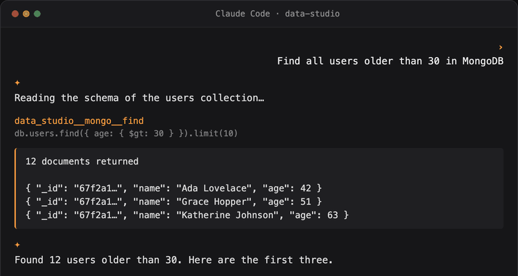

<div align="center">


# Data Studio Agent

**あなたのAIコーディングエージェントが、すべてのデータベースに自然言語で安全にアクセスできるようにします。**

**ローカルファースト。エンタープライズグレードのセキュリティ。オープンソース。**

[](https://github.com/geek-fun/data-studio-agent/releases)
[](https://github.com/geek-fun/data-studio-agent/releases)
[](https://www.npmjs.com/package/@geek-fun/data-studio-mcp)
[](LICENSE)
[](https://github.com/geek-fun/data-studio-agent/stargazers)
[](https://github.com/geek-fun/data-studio-agent/actions/workflows/ci.yml)
[](https://mcptoplist.com/server/io.github.geek-fun%2Fdata-studio)

<p>
  
  
  
  
</p>

<p align="center">
  
</p>

[📖 プロダクトページ](https://www.geekfun.club/products/data-studio-agent/) · [npm](https://www.npmjs.com/package/@geek-fun/data-studio-mcp) · [dockit](https://github.com/geek-fun/dockit) · [sqlkit](https://github.com/geek-fun/sqlkit) · [リリース](https://github.com/geek-fun/data-studio-agent/releases)

[English](README.md) · [简体中文](README_zh.md) · [Português (BR)](README_pt-BR.md) · 日本語 · [한국어](README_ko.md) · [Español](README_es.md)

</div>

---

このリポジトリには **Data Studio MCP Server** が含まれています。これは [Model Context Protocol](https://modelcontextprotocol.io/) サーバーであり、[dockit](https://github.com/geek-fun/dockit) および [sqlkit](https://github.com/geek-fun/sqlkit) デスクトップアプリを通じて、AIコーディングエージェントにデータベースへの直接アクセスを提供します。

- **SQL**（sqlkit経由）：**70以上のデータベース**（PostgreSQL、MySQL、SQL Server、Oracle、SQLite、DuckDB、ClickHouse、Snowflake、BigQuery など）
- **NoSQL**（dockit経由）：Elasticsearch、OpenSearch、MongoDB、DynamoDB

## 特徴

- **あらゆるAIコーディングエージェントに対応。** Claude Code、Cursor、Windsurf、OpenCode、Codex、Cline、Pi、Qoder、GitHub Copilot、または任意のMCPクライアント。
- **あらゆるOSに対応。** macOS、Windows、Linux。
- **あらゆるLLMモデルに対応。** お好みのプロバイダーを利用可能。ロックインなし。
- **1つのMCPサーバー、1つの設定。** localhost経由でSqlKit（SQL）とDocKit（NoSQL）の両方のブリッジにルーティングします。
- **エンタープライズグレードのセキュリティ。** 詳細は下記をご覧ください。

## クイックスタート

### 1. 前提条件

[dockit](https://github.com/geek-fun/dockit) と [sqlkit](https://github.com/geek-fun/sqlkit) をインストールして起動し、データベース接続を追加して、**設定 → MCP Bridge → 自動起動** が有効になっていることを確認してください（デフォルトで有効です）。SQL + NoSQL の完全なツールセットを使うには、両方のアプリをインストールしてください。

### 2. MCPサーバーをインストール

```bash
npm install -g @geek-fun/data-studio-mcp
```

またはインストールせずに実行します（初回実行時に npx がダウンロードします）：

```bash
npx -y @geek-fun/data-studio-mcp
```

### 3. AIツールに追加する

**OpenAI Codex**、コマンド1つ：

```bash
codex mcp add data-studio -- npx -y @geek-fun/data-studio-mcp
```

**Claude Code**、コマンド1つ：

```bash
claude mcp add --transport stdio data-studio -- npx -y @geek-fun/data-studio-mcp
```

**Cursor.** `.cursor/mcp.json`（プロジェクト）または `~/.cursor/mcp.json`（グローバル）を作成します：

```json
{
  "mcpServers": {
    "data-studio": {
      "command": "npx",
      "args": ["-y", "@geek-fun/data-studio-mcp"]
    }
  }
}
```

**Windsurf.** `~/.codeium/windsurf/mcp_config.json`（グローバルのみ）を作成します：

```json
{
  "mcpServers": {
    "data-studio": {
      "command": "npx",
      "args": ["-y", "@geek-fun/data-studio-mcp"]
    }
  }
}
```

**OpenCode.** `opencode.json`（プロジェクト）または `~/.config/opencode/opencode.json`（グローバル）に追加します：

```json
{
  "$schema": "https://opencode.ai/config.json",
  "mcp": {
    "data-studio": {
      "type": "local",
      "command": ["npx", "-y", "@geek-fun/data-studio-mcp"],
      "enabled": true
    }
  }
}
```

**DeepSeek Harness.** オーバーレイを `data-studio.cordis.yml` として保存します：

```yaml
- insert:
    - id: data-studio-mcp
      name: '@deepseek-ai/dsh-mcp-client'
      config:
        serverName: data-studio
        transport: stdio
        command: npx
        args: ['-y', '@geek-fun/data-studio-mcp']
```

`dsh web --patch "$PWD/data-studio.cordis.yml"` を実行するか、`insert` パッチを `$DSH_HOME/cordis.patch.yml` にマージして実行間で保持します。ツールは `mcp__data-studio__*` として表示されます（DSHは開発者プレビューです — 設定の構成は変更される可能性があります）。

**WorkBuddy / CodeBuddy CLI.** コマンド1つ：

```bash
codebuddy mcp add --scope user data-studio -- npx -y @geek-fun/data-studio-mcp
```

または、上記のCursor用に示した同じ `mcpServers` JSON をプロジェクトレベルの `.mcp.json` に追加します（ユーザースコープは `~/.codebuddy/.mcp.json`）。

**その他のMCPクライアント.** コマンド `npx`、引数 `-y @geek-fun/data-studio-mcp` の stdio サーバーを登録します。

### 4. 権限を調整する（任意）

dockit/sqlkit で **設定 → MCP Bridge** を開き、エージェントが実行できる操作を制御します：

| 権限モード | エージェントにできること |
|---|---|
| **読み取り専用**（デフォルト） | スキーマの探索、SELECTクエリの実行。書き込みは不可。 |
| **データ読み書き** | INSERT、UPDATE、インデックス操作。削除/ドロップは不可。 |
| **フルアクセス** | DELETE、DROP、TRUNCATEを含むすべての操作。 |

### 5. 質問を始める

自然言語でそのまま質問してください。エージェントがあなたに代わってデータベースへ問い合わせます：

- "私のPostgreSQLデータベースのすべてのテーブルを一覧表示して"
- "Elasticsearchの `orders*` インデックスから直近10件の注文を見せて"
- "MongoDBで30歳以上のユーザーをすべて検索して"
- "このクエリを実行して結果を説明して"

エージェントはスキーマを読み取り、クエリを実行し、データを探索します。そして、実行したすべてのクエリを表示します。

## エンタープライズグレードのセキュリティ

LLMはあなたのデータへ広範なアクセスを行いますが、資格情報を見ることはありません。ポリシーモデルがすべての機能をリスクレベルで管理します。

- **資格情報はアプリの外に出ません。** LLMが見られるのは不透明な `connection_id` だけです。実際の資格情報は dockit/sqlkit の内部で解決され、MCPの境界を越えることはありません。パスワードやキーはあなたのマシン上、アプリの中に留まります。
- **IDベースのリソースアクセス。** エージェントは接続IDによってのみデータベースにアクセスします。資格情報はプロンプトやツール引数に現れないため、モデルが接続シークレットを取得したり外部に持ち出したりする経路はありません。
- **3段階の権限モデル。** 読み取り専用 / データ読み書き / フルアクセスの各モードが、すべての機能をリスクレベルで制御します。接続ごとの上書きも可能です。任意の接続を読み取り専用にしたり、特定のアクションを許可リストに追加したりできます。
- **明示的なユーザー確認。** 破壊的な操作（DELETE、DROP、TRUNCATE）はポリシー上 `Ask` として表示されます。クライアントは、破壊的な操作を実行する前にユーザーに明示的な確認を求めます。
- **アクションレベルのステートメント分類。** SQLは実行前にステートメントの種類（読み取り / 書き込み / 削除 / DDL）ごとに解析・分類されます。書き込み専用ツールはDELETEステートメントを拒否し、削除ツールはDDLを拒否します。
- **ローカル専用ブリッジ。** ブリッジは `127.0.0.1` のみにバインドします。他のマシンからは到達できず、ホストするサーバーも、管理するAPIキーもありません。

## ツール

すべてのツールは `data_studio__{app}__{backend}__{action}` の命名規則に従います。**app** はブリッジを公開するデスクトップアプリ（`sqlkit` または `dockit`）、**backend** はその背後にあるデータソース（`sqlkit`、`es`、`mongo`、`dynamo`）です。2つのサーバーレベルツール（`data_studio__list_connections`、`data_studio__get_status`）にはappセグメントがありません。**ユーザー確認** 列は、実行前にAIクライアントで明示的な確認プロンプトが表示される操作を示しています。

実行時に公開されるツールセットの正確な内容は、アプリの権限モードと設定済みの接続によって異なります — `data_studio__get_status` を呼び出して、現在利用可能なツールを確認してください。

| ツール | バックエンド | リスク | 必要な権限 | ユーザー確認 |
|---|---|---|---|---|
| `data_studio__list_connections` | サーバー | 🟢 安全 | 読み取り専用 | いいえ |
| `data_studio__get_status` | サーバー | 🟢 安全 | 読み取り専用 | いいえ |
| `data_studio__dockit__dockit__list_connections` | dockit | 🟢 安全 | 読み取り専用 | いいえ |
| `data_studio__sqlkit__sqlkit__list_databases` | sqlkit | 🟢 安全 | 読み取り専用 | いいえ |
| `data_studio__sqlkit__sqlkit__list_schemas` | sqlkit | 🟢 安全 | 読み取り専用 | いいえ |
| `data_studio__sqlkit__sqlkit__list_tables` | sqlkit | 🟢 安全 | 読み取り専用 | いいえ |
| `data_studio__sqlkit__sqlkit__get_schema` | sqlkit | 🟢 安全 | 読み取り専用 | いいえ |
| `data_studio__sqlkit__sqlkit__describe_table` | sqlkit | 🟢 安全 | 読み取り専用 | いいえ |
| `data_studio__sqlkit__sqlkit__explain_query` | sqlkit | 🟢 安全 | 読み取り専用 | いいえ |
| `data_studio__sqlkit__sqlkit__list_indexes` | sqlkit | 🟢 安全 | 読み取り専用 | いいえ |
| `data_studio__sqlkit__sqlkit__list_foreign_keys` | sqlkit | 🟢 安全 | 読み取り専用 | いいえ |
| `data_studio__sqlkit__sqlkit__list_views` | sqlkit | 🟢 安全 | 読み取り専用 | いいえ |
| `data_studio__sqlkit__sqlkit__list_procedures` | sqlkit | 🟢 安全 | 読み取り専用 | いいえ |
| `data_studio__sqlkit__sqlkit__list_functions` | sqlkit | 🟢 安全 | 読み取り専用 | いいえ |
| `data_studio__sqlkit__sqlkit__list_triggers` | sqlkit | 🟢 安全 | 読み取り専用 | いいえ |
| `data_studio__sqlkit__sqlkit__get_table_info` | sqlkit | 🟢 安全 | 読み取り専用 | いいえ |
| `data_studio__sqlkit__sqlkit__get_foreign_keys` | sqlkit | 🟢 安全 | 読み取り専用 | いいえ |
| `data_studio__sqlkit__sqlkit__list_sessions` | sqlkit | 🟢 安全 | 読み取り専用 | いいえ |
| `data_studio__sqlkit__sqlkit__get_slow_queries` | sqlkit | 🟢 安全 | 読み取り専用 | いいえ |
| `data_studio__sqlkit__sqlkit__list_connections` | sqlkit | 🟢 安全 | 読み取り専用 | いいえ |
| `data_studio__sqlkit__sqlkit__execute_query` | sqlkit | 🟢 安全 | 読み取り専用 | いいえ |
| `data_studio__sqlkit__sqlkit__get_object_ddl` | sqlkit | 🟢 安全 | 読み取り専用 | いいえ |
| `data_studio__sqlkit__sqlkit__execute_write` | sqlkit | 🟡 高権限 | データ読み書き | いいえ |
| `data_studio__sqlkit__sqlkit__kill_session` | sqlkit | 🟡 高権限 | データ読み書き | いいえ |
| `data_studio__sqlkit__sqlkit__grant_privilege` | sqlkit | 🟡 高権限 | データ読み書き | いいえ |
| `data_studio__sqlkit__sqlkit__revoke_privilege` | sqlkit | 🟡 高権限 | データ読み書き | いいえ |
| `data_studio__sqlkit__sqlkit__execute_delete` | sqlkit | 🔴 破壊的 | フルアクセス | はい |
| `data_studio__sqlkit__sqlkit__execute_ddl` | sqlkit | 🔴 破壊的 | フルアクセス | はい |
| `data_studio__dockit__es__search` | dockit · Elasticsearch | 🟢 安全 | 読み取り専用 | いいえ |
| `data_studio__dockit__es__get_document` | dockit · Elasticsearch | 🟢 安全 | 読み取り専用 | いいえ |
| `data_studio__dockit__es__cat_indices` | dockit · Elasticsearch | 🟢 安全 | 読み取り専用 | いいえ |
| `data_studio__dockit__es__get_mapping` | dockit · Elasticsearch | 🟢 安全 | 読み取り専用 | いいえ |
| `data_studio__dockit__es__cat_aliases` | dockit · Elasticsearch | 🟢 安全 | 読み取り専用 | いいえ |
| `data_studio__dockit__es__get_alias` | dockit · Elasticsearch | 🟢 安全 | 読み取り専用 | いいえ |
| `data_studio__dockit__es__count` | dockit · Elasticsearch | 🟢 安全 | 読み取り専用 | いいえ |
| `data_studio__dockit__es__cluster_health` | dockit · Elasticsearch | 🟢 安全 | 読み取り専用 | いいえ |
| `data_studio__dockit__es__cat_nodes` | dockit · Elasticsearch | 🟢 安全 | 読み取り専用 | いいえ |
| `data_studio__dockit__es__cat_shards` | dockit · Elasticsearch | 🟢 安全 | 読み取り専用 | いいえ |
| `data_studio__dockit__es__list_snapshots` | dockit · Elasticsearch | 🟢 安全 | 読み取り専用 | いいえ |
| `data_studio__dockit__es__index_document` | dockit · Elasticsearch | 🟡 高権限 | データ読み書き | いいえ |
| `data_studio__dockit__es__update_document` | dockit · Elasticsearch | 🟡 高権限 | データ読み書き | いいえ |
| `data_studio__dockit__es__create_index` | dockit · Elasticsearch | 🟡 高権限 | データ読み書き | いいえ |
| `data_studio__dockit__es__put_mapping` | dockit · Elasticsearch | 🟡 高権限 | データ読み書き | いいえ |
| `data_studio__dockit__es__put_alias` | dockit · Elasticsearch | 🟡 高権限 | データ読み書き | いいえ |
| `data_studio__dockit__es__update_aliases` | dockit · Elasticsearch | 🟡 高権限 | データ読み書き | いいえ |
| `data_studio__dockit__es__bulk` | dockit · Elasticsearch | 🟡 高権限 | データ読み書き | いいえ |
| `data_studio__dockit__es__reindex` | dockit · Elasticsearch | 🟡 高権限 | データ読み書き | いいえ |
| `data_studio__dockit__es__restore_snapshot` | dockit · Elasticsearch | 🟡 高権限 | データ読み書き | いいえ |
| `data_studio__dockit__es__delete_document` | dockit · Elasticsearch | 🔴 破壊的 | フルアクセス | はい |
| `data_studio__dockit__es__delete_by_query` | dockit · Elasticsearch | 🔴 破壊的 | フルアクセス | はい |
| `data_studio__dockit__es__delete_index` | dockit · Elasticsearch | 🔴 破壊的 | フルアクセス | はい |
| `data_studio__dockit__es__delete_alias` | dockit · Elasticsearch | 🔴 破壊的 | フルアクセス | はい |
| `data_studio__dockit__mongo__list_databases` | dockit · MongoDB | 🟢 安全 | 読み取り専用 | いいえ |
| `data_studio__dockit__mongo__list_collections` | dockit · MongoDB | 🟢 安全 | 読み取り専用 | いいえ |
| `data_studio__dockit__mongo__find` | dockit · MongoDB | 🟢 安全 | 読み取り専用 | いいえ |
| `data_studio__dockit__mongo__collection_stats` | dockit · MongoDB | 🟢 安全 | 読み取り専用 | いいえ |
| `data_studio__dockit__mongo__database_stats` | dockit · MongoDB | 🟢 安全 | 読み取り専用 | いいえ |
| `data_studio__dockit__mongo__server_status` | dockit · MongoDB | 🟢 安全 | 読み取り専用 | いいえ |
| `data_studio__dockit__mongo__repl_set_status` | dockit · MongoDB | 🟢 安全 | 読み取り専用 | いいえ |
| `data_studio__dockit__mongo__shard_status` | dockit · MongoDB | 🟢 安全 | 読み取り専用 | いいえ |
| `data_studio__dockit__mongo__count_documents` | dockit · MongoDB | 🟢 安全 | 読み取り専用 | いいえ |
| `data_studio__dockit__mongo__list_indexes` | dockit · MongoDB | 🟢 安全 | 読み取り専用 | いいえ |
| `data_studio__dockit__mongo__sample_documents` | dockit · MongoDB | 🟢 安全 | 読み取り専用 | いいえ |
| `data_studio__dockit__mongo__distinct` | dockit · MongoDB | 🟢 安全 | 読み取り専用 | いいえ |
| `data_studio__dockit__mongo__get_slow_queries` | dockit · MongoDB | 🟢 安全 | 読み取り専用 | いいえ |
| `data_studio__dockit__mongo__list_users` | dockit · MongoDB | 🟢 安全 | 読み取り専用 | いいえ |
| `data_studio__dockit__mongo__aggregate` | dockit · MongoDB | 🟡 高権限 | データ読み書き | いいえ |
| `data_studio__dockit__mongo__insert_one` | dockit · MongoDB | 🟡 高権限 | データ読み書き | いいえ |
| `data_studio__dockit__mongo__update_many` | dockit · MongoDB | 🟡 高権限 | データ読み書き | いいえ |
| `data_studio__dockit__mongo__create_database` | dockit · MongoDB | 🟡 高権限 | データ読み書き | いいえ |
| `data_studio__dockit__mongo__create_collection` | dockit · MongoDB | 🟡 高権限 | データ読み書き | いいえ |
| `data_studio__dockit__mongo__update_document` | dockit · MongoDB | 🟡 高権限 | データ読み書き | いいえ |
| `data_studio__dockit__mongo__rename_collection` | dockit · MongoDB | 🟡 高権限 | データ読み書き | いいえ |
| `data_studio__dockit__mongo__clone_collection` | dockit · MongoDB | 🟡 高権限 | データ読み書き | いいえ |
| `data_studio__dockit__mongo__create_index` | dockit · MongoDB | 🟡 高権限 | データ読み書き | いいえ |
| `data_studio__dockit__mongo__drop_index` | dockit · MongoDB | 🟡 高権限 | データ読み書き | いいえ |
| `data_studio__dockit__mongo__insert_many` | dockit · MongoDB | 🟡 高権限 | データ読み書き | いいえ |
| `data_studio__dockit__mongo__find_one_and_update` | dockit · MongoDB | 🟡 高権限 | データ読み書き | いいえ |
| `data_studio__dockit__mongo__bulk_write` | dockit · MongoDB | 🟡 高権限 | データ読み書き | いいえ |
| `data_studio__dockit__mongo__delete_many` | dockit · MongoDB | 🔴 破壊的 | フルアクセス | はい |
| `data_studio__dockit__mongo__drop_database` | dockit · MongoDB | 🔴 破壊的 | フルアクセス | はい |
| `data_studio__dockit__mongo__drop_collection` | dockit · MongoDB | 🔴 破壊的 | フルアクセス | はい |
| `data_studio__dockit__mongo__delete_document` | dockit · MongoDB | 🔴 破壊的 | フルアクセス | はい |
| `data_studio__dockit__mongo__truncate_collection` | dockit · MongoDB | 🔴 破壊的 | フルアクセス | はい |
| `data_studio__dockit__dynamo__execute_query` | dockit · DynamoDB | 🟢 安全 | 読み取り専用 | いいえ |
| `data_studio__dockit__dynamo__describe_table` | dockit · DynamoDB | 🟢 安全 | 読み取り専用 | いいえ |
| `data_studio__dockit__dynamo__list_tables` | dockit · DynamoDB | 🟢 安全 | 読み取り専用 | いいえ |
| `data_studio__dockit__dynamo__query_table` | dockit · DynamoDB | 🟢 安全 | 読み取り専用 | いいえ |
| `data_studio__dockit__dynamo__scan_table` | dockit · DynamoDB | 🟢 安全 | 読み取り専用 | いいえ |
| `data_studio__dockit__dynamo__batch_get_items` | dockit · DynamoDB | 🟢 安全 | 読み取り専用 | いいえ |
| `data_studio__dockit__dynamo__describe_continuous_backups` | dockit · DynamoDB | 🟢 安全 | 読み取り専用 | いいえ |
| `data_studio__dockit__dynamo__describe_ttl` | dockit · DynamoDB | 🟢 安全 | 読み取り専用 | いいえ |
| `data_studio__dockit__dynamo__get_table_metrics` | dockit · DynamoDB | 🟢 安全 | 読み取り専用 | いいえ |
| `data_studio__dockit__dynamo__list_backups` | dockit · DynamoDB | 🟢 安全 | 読み取り専用 | いいえ |
| `data_studio__dockit__dynamo__describe_backup` | dockit · DynamoDB | 🟢 安全 | 読み取り専用 | いいえ |
| `data_studio__dockit__dynamo__describe_limits` | dockit · DynamoDB | 🟢 安全 | 読み取り専用 | いいえ |
| `data_studio__dockit__dynamo__list_tags` | dockit · DynamoDB | 🟢 安全 | 読み取り専用 | いいえ |
| `data_studio__dockit__dynamo__execute_write` | dockit · DynamoDB | 🟡 高権限 | データ読み書き | いいえ |
| `data_studio__dockit__dynamo__create_item` | dockit · DynamoDB | 🟡 高権限 | データ読み書き | いいえ |
| `data_studio__dockit__dynamo__batch_write_items` | dockit · DynamoDB | 🟡 高権限 | データ読み書き | いいえ |
| `data_studio__dockit__dynamo__update_item` | dockit · DynamoDB | 🟡 高権限 | データ読み書き | いいえ |
| `data_studio__dockit__dynamo__transact_write_items` | dockit · DynamoDB | 🟡 高権限 | データ読み書き | いいえ |
| `data_studio__dockit__dynamo__create_gsi` | dockit · DynamoDB | 🟡 高権限 | データ読み書き | いいえ |
| `data_studio__dockit__dynamo__update_gsi` | dockit · DynamoDB | 🟡 高権限 | データ読み書き | いいえ |
| `data_studio__dockit__dynamo__create_table` | dockit · DynamoDB | 🟡 高権限 | データ読み書き | いいえ |
| `data_studio__dockit__dynamo__update_table_config` | dockit · DynamoDB | 🟡 高権限 | データ読み書き | いいえ |
| `data_studio__dockit__dynamo__update_ttl` | dockit · DynamoDB | 🟡 高権限 | データ読み書き | いいえ |
| `data_studio__dockit__dynamo__update_pitr` | dockit · DynamoDB | 🟡 高権限 | データ読み書き | いいえ |
| `data_studio__dockit__dynamo__update_streams` | dockit · DynamoDB | 🟡 高権限 | データ読み書き | いいえ |
| `data_studio__dockit__dynamo__restore_table` | dockit · DynamoDB | 🟡 高権限 | データ読み書き | いいえ |
| `data_studio__dockit__dynamo__create_backup` | dockit · DynamoDB | 🟡 高権限 | データ読み書き | いいえ |
| `data_studio__dockit__dynamo__tag_resource` | dockit · DynamoDB | 🟡 高権限 | データ読み書き | いいえ |
| `data_studio__dockit__dynamo__execute_delete` | dockit · DynamoDB | 🔴 破壊的 | フルアクセス | はい |
| `data_studio__dockit__dynamo__delete_item` | dockit · DynamoDB | 🔴 破壊的 | フルアクセス | はい |
| `data_studio__dockit__dynamo__delete_gsi` | dockit · DynamoDB | 🔴 破壊的 | フルアクセス | はい |
| `data_studio__dockit__dynamo__delete_table` | dockit · DynamoDB | 🔴 破壊的 | フルアクセス | はい |
| `data_studio__dockit__dynamo__truncate_table` | dockit · DynamoDB | 🔴 破壊的 | フルアクセス | はい |
**合計117ツール。** 読み取り専用の操作は **読み取り専用** モードで自動的に実行されます。高権限の操作（書き込み、インデックス/スキーマ変更）には **データ読み書き** が必要です。破壊的な操作（DELETE、DROP、TRUNCATE）には **フルアクセス** が必要で、常に明示的な **ユーザー確認** プロンプトが表示されます。

## 仕組み

```
AIコーディングエージェント (Claude Code / Cursor / OpenCode ...)
    |
    | MCP stdio プロトコル
    v
@geek-fun/data-studio-mcp   ← npm パッケージ（TypeScript製）
    |
    | HTTP (localhost)
    +----------------+----------------+
    v                v                |
dockit:9120    sqlkit:9121            |
(NoSQL bridge)  (SQL bridge)          |
    |                |                |
    v                v                |
Elasticsearch    PostgreSQL           |
MongoDB          MySQL                |
DynamoDB         SQL Server           |
OpenSearch       SQLite               |
```

MCPサーバーは薄いルーティング層です。すべてのデータベースドライバ、SSHトンネル、接続管理はデスクトップアプリ側にあり、アプリはローカルHTTPブリッジ（`127.0.0.1` のみ）を公開します。MCPサーバーは各アプリのポートファイルを通じて、実行中のバックエンドを自動検出します。

---

## 開発者向け

このリポジトリには、[dockit](https://github.com/geek-fun/dockit) と [sqlkit](https://github.com/geek-fun/sqlkit) の組み込みアシスタントを支える共通のAIエージェントループ（プロバイダーアダプター、ストリーミング、ツール呼び出し、コンテキスト圧縮）である **data-studio-agent Rustフレームワーク** も含まれています。

インストール、アーキテクチャ、統合のガイドは [crates/data-studio-agent/README.md](crates/data-studio-agent/README.md) をご覧ください。

## ライセンス

Apache 2.0。詳細は [LICENSE](LICENSE) をご覧ください。
