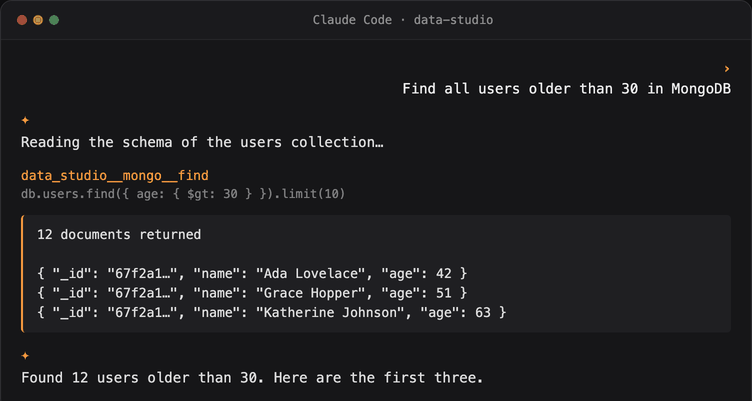

<div align="center">


# Data Studio Agent

**당신의 AI 코딩 에이전트가 모든 데이터베이스에 자연어로 안전하게 접근하도록 하세요.**

**로컬 우선. 엔터프라이즈급 보안. 오픈 소스.**

[](https://github.com/geek-fun/data-studio-agent/releases)
[](https://github.com/geek-fun/data-studio-agent/releases)
[](https://www.npmjs.com/package/@geek-fun/data-studio-mcp)
[](LICENSE)
[](https://github.com/geek-fun/data-studio-agent/stargazers)
[](https://github.com/geek-fun/data-studio-agent/actions/workflows/ci.yml)
[](https://mcptoplist.com/server/io.github.geek-fun%2Fdata-studio)

<p>
  
  
  
  
</p>

<p align="center">
  
</p>

[📖 제품 페이지](https://www.geekfun.club/products/data-studio-agent/) · [npm](https://www.npmjs.com/package/@geek-fun/data-studio-mcp) · [dockit](https://github.com/geek-fun/dockit) · [sqlkit](https://github.com/geek-fun/sqlkit) · [릴리스](https://github.com/geek-fun/data-studio-agent/releases)

[English](README.md) · [简体中文](README_zh.md) · [Português (BR)](README_pt-BR.md) · [日本語](README_ja.md) · 한국어 · [Español](README_es.md)

</div>

---

이 리포지토리에는 **Data Studio MCP Server**가 포함되어 있습니다. [Model Context Protocol](https://modelcontextprotocol.io/) 서버로서, [dockit](https://github.com/geek-fun/dockit) 및 [sqlkit](https://github.com/geek-fun/sqlkit) 데스크톱 앱을 통해 AI 코딩 에이전트에 데이터베이스 직접 접근을 제공합니다.

- **SQL**(sqlkit 통해): **70개 이상의 데이터베이스**(PostgreSQL, MySQL, SQL Server, Oracle, SQLite, DuckDB, ClickHouse, Snowflake, BigQuery 등)
- **NoSQL**(dockit 통해): Elasticsearch, OpenSearch, MongoDB, DynamoDB

## 주요 기능

- **어떤 AI 코딩 에이전트든 사용 가능.** Claude Code, Cursor, Windsurf, OpenCode, Codex, Cline, Pi, Qoder, GitHub Copilot, 또는 모든 MCP 클라이언트.
- **어떤 OS든 사용 가능.** macOS, Windows, Linux.
- **어떤 LLM 모델이든 사용 가능.** 원하는 프로바이더를 가져오세요. 락인 없음.
- **MCP 서버 하나, 설정 하나.** localhost를 통해 SqlKit(SQL)과 DocKit(NoSQL) 브리지 양쪽으로 라우팅합니다.
- **엔터프라이즈급 보안.** 아래 내용을 참고하세요.

## 빠른 시작

### 1. 사전 요구 사항

[dockit](https://github.com/geek-fun/dockit) 및/또는 [sqlkit](https://github.com/geek-fun/sqlkit)을 설치하고 실행한 다음, 데이터베이스 연결을 추가하고 **설정 → MCP Bridge → 자동 시작**이 활성화되어 있는지 확인하세요(기본값은 활성화입니다). SQL + NoSQL 전체 도구 세트를 사용하려면 두 앱을 모두 설치하세요.

### 2. MCP 서버 설치

```bash
npm install -g @geek-fun/data-studio-mcp
```

또는 설치하지 않고 바로 실행하세요(첫 실행 시 npx가 다운로드합니다):

```bash
npx -y @geek-fun/data-studio-mcp
```

### 3. AI 도구에 추가하기

**OpenAI Codex**, 명령 한 줄:

```bash
codex mcp add data-studio -- npx -y @geek-fun/data-studio-mcp
```

**Claude Code**, 명령 한 줄:

```bash
claude mcp add --transport stdio data-studio -- npx -y @geek-fun/data-studio-mcp
```

**Cursor.** `.cursor/mcp.json`(프로젝트) 또는 `~/.cursor/mcp.json`(전역)을 생성합니다:

```json
{
  "mcpServers": {
    "data-studio": {
      "command": "npx",
      "args": ["-y", "@geek-fun/data-studio-mcp"]
    }
  }
}
```

**Windsurf.** `~/.codeium/windsurf/mcp_config.json`(전역 전용)을 생성합니다:

```json
{
  "mcpServers": {
    "data-studio": {
      "command": "npx",
      "args": ["-y", "@geek-fun/data-studio-mcp"]
    }
  }
}
```

**OpenCode.** `opencode.json`(프로젝트) 또는 `~/.config/opencode/opencode.json`(전역)에 추가합니다:

```json
{
  "$schema": "https://opencode.ai/config.json",
  "mcp": {
    "data-studio": {
      "type": "local",
      "command": ["npx", "-y", "@geek-fun/data-studio-mcp"],
      "enabled": true
    }
  }
}
```

**DeepSeek Harness.** 오버레이를 `data-studio.cordis.yml`로 저장합니다:

```yaml
- insert:
    - id: data-studio-mcp
      name: '@deepseek-ai/dsh-mcp-client'
      config:
        serverName: data-studio
        transport: stdio
        command: npx
        args: ['-y', '@geek-fun/data-studio-mcp']
```

`dsh web --patch "$PWD/data-studio.cordis.yml"`를 실행하거나, `insert` 패치를 `$DSH_HOME/cordis.patch.yml`에 병합하여 실행 간에 유지하세요. 도구는 `mcp__data-studio__*` 형태로 나타납니다(DSH는 개발자 프리뷰 단계입니다 — 설정 구조는 변경될 수 있습니다).

**WorkBuddy / CodeBuddy CLI.** 명령 한 줄:

```bash
codebuddy mcp add --scope user data-studio -- npx -y @geek-fun/data-studio-mcp
```

또는 위에서 Cursor용으로 보여준 것과 동일한 `mcpServers` JSON을 프로젝트 수준 `.mcp.json`에 추가하세요(사용자 스코프는 `~/.codebuddy/.mcp.json`).

**그 밖의 모든 MCP 클라이언트.** 명령 `npx`, 인수 `-y @geek-fun/data-studio-mcp`로 stdio 서버를 등록합니다.

### 4. 권한 조정(선택 사항)

dockit/sqlkit에서 **설정 → MCP Bridge**를 열어 에이전트가 할 수 있는 작업을 제어합니다:

| 권한 모드 | 에이전트가 할 수 있는 작업 |
|---|---|
| **읽기 전용**(기본값) | 스키마 탐색, SELECT 쿼리 실행. 쓰기는 불가. |
| **데이터 읽기/쓰기** | INSERT, UPDATE, 인덱스 작업. 삭제/드롭은 불가. |
| **전체 접근** | DELETE, DROP, TRUNCATE를 포함한 모든 작업. |

### 5. 질문 시작하기

자연어로 말하면 됩니다. 에이전트가 대신 데이터베이스에 질의합니다:

- "내 PostgreSQL 데이터베이스의 모든 테이블을 나열해 줘"
- "Elasticsearch `orders*` 인덱스에서 최근 10건의 주문을 보여 줘"
- "MongoDB에서 30세 이상인 모든 사용자를 찾아 줘"
- "이 쿼리를 실행하고 결과를 설명해 줘"

에이전트는 스키마를 읽고, 쿼리를 실행하고, 데이터를 탐색한 다음 실행한 모든 쿼리를 보여 줍니다.

## 엔터프라이즈급 보안

LLM은 데이터에 대한 폭넓은 접근 권한을 갖지만, 자격 증명은 절대 볼 수 없습니다. 정책 모델이 모든 기능을 위험 수준별로 통제합니다.

- **자격 증명은 앱 밖으로 나가지 않습니다.** LLM에게 보이는 것은 불투명한 `connection_id`뿐입니다. 실제 자격 증명은 dockit/sqlkit 내부에서 처리되며 MCP 경계를 넘지 않습니다. 비밀번호와 키는 사용자의 머신, 사용자의 앱 안에 머무릅니다.
- **ID 기반 리소스 접근.** 에이전트는 오직 연결 ID로만 데이터베이스에 접근합니다. 자격 증명은 프롬프트나 도구 인수에 나타나지 않으므로, 모델이 연결 시크릿을 획득하거나 유출할 경로가 없습니다.
- **3단계 권한 모델.** 읽기 전용 / 데이터 읽기-쓰기 / 전체 접근 모드가 모든 기능을 위험 수준별로 통제하며, 연결별 재정의도 지원합니다. 어떤 연결이든 읽기 전용으로 표시하거나 특정 작업을 허용 목록에 지정할 수 있습니다.
- **명시적 사용자 확인.** 파괴적 작업(DELETE, DROP, TRUNCATE)은 정책에서 `Ask`로 표시됩니다. 클라이언트는 파괴적인 작업이 실행되기 전에 사용자에게 명시적인 확인을 요청합니다.
- **작업 수준 문 분류.** SQL은 실행 전에 문 유형(읽기 / 쓰기 / 삭제 / DDL)별로 파싱되고 분류됩니다. 쓰기 전용 도구는 DELETE 문을 거부하고, 삭제 도구는 DDL을 거부합니다.
- **로컬 전용 브리지.** 브리지는 `127.0.0.1`에만 바인딩됩니다. 다른 머신에서는 접근할 수 없으며, 호스팅할 서버도, 관리할 API 키도 없습니다.

## 도구

모든 도구는 `data_studio__{app}__{backend}__{action}` 명명 규칙을 따릅니다. **app**은 브리지를 노출하는 데스크톱 앱(`sqlkit` 또는 `dockit`)이고, **backend**는 그 뒤에 있는 데이터 소스(`sqlkit`, `es`, `mongo`, `dynamo`)입니다. 두 개의 서버 수준 도구(`data_studio__list_connections`, `data_studio__get_status`)에는 app 세그먼트가 없습니다. **사용자 확인** 열은 실행 전에 AI 클라이언트에서 명시적 확인 프롬프트가 표시되는 작업을 보여 줍니다.

런타임에 공개되는 실제 도구 세트는 앱의 권한 모드와 구성된 연결에 따라 달라집니다 — `data_studio__get_status`를 호출하면 현재 사용 가능한 도구를 확인할 수 있습니다.

| 도구 | 백엔드 | 위험도 | 필요 권한 | 사용자 확인 |
|---|---|---|---|---|
| `data_studio__list_connections` | 서버 | 🟢 안전 | 읽기 전용 | 아니요 |
| `data_studio__get_status` | 서버 | 🟢 안전 | 읽기 전용 | 아니요 |
| `data_studio__dockit__dockit__list_connections` | dockit | 🟢 안전 | 읽기 전용 | 아니요 |
| `data_studio__sqlkit__sqlkit__list_databases` | sqlkit | 🟢 안전 | 읽기 전용 | 아니요 |
| `data_studio__sqlkit__sqlkit__list_schemas` | sqlkit | 🟢 안전 | 읽기 전용 | 아니요 |
| `data_studio__sqlkit__sqlkit__list_tables` | sqlkit | 🟢 안전 | 읽기 전용 | 아니요 |
| `data_studio__sqlkit__sqlkit__get_schema` | sqlkit | 🟢 안전 | 읽기 전용 | 아니요 |
| `data_studio__sqlkit__sqlkit__describe_table` | sqlkit | 🟢 안전 | 읽기 전용 | 아니요 |
| `data_studio__sqlkit__sqlkit__explain_query` | sqlkit | 🟢 안전 | 읽기 전용 | 아니요 |
| `data_studio__sqlkit__sqlkit__list_indexes` | sqlkit | 🟢 안전 | 읽기 전용 | 아니요 |
| `data_studio__sqlkit__sqlkit__list_foreign_keys` | sqlkit | 🟢 안전 | 읽기 전용 | 아니요 |
| `data_studio__sqlkit__sqlkit__list_views` | sqlkit | 🟢 안전 | 읽기 전용 | 아니요 |
| `data_studio__sqlkit__sqlkit__list_procedures` | sqlkit | 🟢 안전 | 읽기 전용 | 아니요 |
| `data_studio__sqlkit__sqlkit__list_functions` | sqlkit | 🟢 안전 | 읽기 전용 | 아니요 |
| `data_studio__sqlkit__sqlkit__list_triggers` | sqlkit | 🟢 안전 | 읽기 전용 | 아니요 |
| `data_studio__sqlkit__sqlkit__get_table_info` | sqlkit | 🟢 안전 | 읽기 전용 | 아니요 |
| `data_studio__sqlkit__sqlkit__get_foreign_keys` | sqlkit | 🟢 안전 | 읽기 전용 | 아니요 |
| `data_studio__sqlkit__sqlkit__list_sessions` | sqlkit | 🟢 안전 | 읽기 전용 | 아니요 |
| `data_studio__sqlkit__sqlkit__get_slow_queries` | sqlkit | 🟢 안전 | 읽기 전용 | 아니요 |
| `data_studio__sqlkit__sqlkit__list_connections` | sqlkit | 🟢 안전 | 읽기 전용 | 아니요 |
| `data_studio__sqlkit__sqlkit__execute_query` | sqlkit | 🟢 안전 | 읽기 전용 | 아니요 |
| `data_studio__sqlkit__sqlkit__get_object_ddl` | sqlkit | 🟢 안전 | 읽기 전용 | 아니요 |
| `data_studio__sqlkit__sqlkit__execute_write` | sqlkit | 🟡 상승 | 데이터 읽기-쓰기 | 아니요 |
| `data_studio__sqlkit__sqlkit__kill_session` | sqlkit | 🟡 상승 | 데이터 읽기-쓰기 | 아니요 |
| `data_studio__sqlkit__sqlkit__grant_privilege` | sqlkit | 🟡 상승 | 데이터 읽기-쓰기 | 아니요 |
| `data_studio__sqlkit__sqlkit__revoke_privilege` | sqlkit | 🟡 상승 | 데이터 읽기-쓰기 | 아니요 |
| `data_studio__sqlkit__sqlkit__execute_delete` | sqlkit | 🔴 파괴적 | 전체 접근 | 예 |
| `data_studio__sqlkit__sqlkit__execute_ddl` | sqlkit | 🔴 파괴적 | 전체 접근 | 예 |
| `data_studio__dockit__es__search` | dockit · Elasticsearch | 🟢 안전 | 읽기 전용 | 아니요 |
| `data_studio__dockit__es__get_document` | dockit · Elasticsearch | 🟢 안전 | 읽기 전용 | 아니요 |
| `data_studio__dockit__es__cat_indices` | dockit · Elasticsearch | 🟢 안전 | 읽기 전용 | 아니요 |
| `data_studio__dockit__es__get_mapping` | dockit · Elasticsearch | 🟢 안전 | 읽기 전용 | 아니요 |
| `data_studio__dockit__es__cat_aliases` | dockit · Elasticsearch | 🟢 안전 | 읽기 전용 | 아니요 |
| `data_studio__dockit__es__get_alias` | dockit · Elasticsearch | 🟢 안전 | 읽기 전용 | 아니요 |
| `data_studio__dockit__es__count` | dockit · Elasticsearch | 🟢 안전 | 읽기 전용 | 아니요 |
| `data_studio__dockit__es__cluster_health` | dockit · Elasticsearch | 🟢 안전 | 읽기 전용 | 아니요 |
| `data_studio__dockit__es__cat_nodes` | dockit · Elasticsearch | 🟢 안전 | 읽기 전용 | 아니요 |
| `data_studio__dockit__es__cat_shards` | dockit · Elasticsearch | 🟢 안전 | 읽기 전용 | 아니요 |
| `data_studio__dockit__es__list_snapshots` | dockit · Elasticsearch | 🟢 안전 | 읽기 전용 | 아니요 |
| `data_studio__dockit__es__index_document` | dockit · Elasticsearch | 🟡 상승 | 데이터 읽기-쓰기 | 아니요 |
| `data_studio__dockit__es__update_document` | dockit · Elasticsearch | 🟡 상승 | 데이터 읽기-쓰기 | 아니요 |
| `data_studio__dockit__es__create_index` | dockit · Elasticsearch | 🟡 상승 | 데이터 읽기-쓰기 | 아니요 |
| `data_studio__dockit__es__put_mapping` | dockit · Elasticsearch | 🟡 상승 | 데이터 읽기-쓰기 | 아니요 |
| `data_studio__dockit__es__put_alias` | dockit · Elasticsearch | 🟡 상승 | 데이터 읽기-쓰기 | 아니요 |
| `data_studio__dockit__es__update_aliases` | dockit · Elasticsearch | 🟡 상승 | 데이터 읽기-쓰기 | 아니요 |
| `data_studio__dockit__es__bulk` | dockit · Elasticsearch | 🟡 상승 | 데이터 읽기-쓰기 | 아니요 |
| `data_studio__dockit__es__reindex` | dockit · Elasticsearch | 🟡 상승 | 데이터 읽기-쓰기 | 아니요 |
| `data_studio__dockit__es__restore_snapshot` | dockit · Elasticsearch | 🟡 상승 | 데이터 읽기-쓰기 | 아니요 |
| `data_studio__dockit__es__delete_document` | dockit · Elasticsearch | 🔴 파괴적 | 전체 접근 | 예 |
| `data_studio__dockit__es__delete_by_query` | dockit · Elasticsearch | 🔴 파괴적 | 전체 접근 | 예 |
| `data_studio__dockit__es__delete_index` | dockit · Elasticsearch | 🔴 파괴적 | 전체 접근 | 예 |
| `data_studio__dockit__es__delete_alias` | dockit · Elasticsearch | 🔴 파괴적 | 전체 접근 | 예 |
| `data_studio__dockit__mongo__list_databases` | dockit · MongoDB | 🟢 안전 | 읽기 전용 | 아니요 |
| `data_studio__dockit__mongo__list_collections` | dockit · MongoDB | 🟢 안전 | 읽기 전용 | 아니요 |
| `data_studio__dockit__mongo__find` | dockit · MongoDB | 🟢 안전 | 읽기 전용 | 아니요 |
| `data_studio__dockit__mongo__collection_stats` | dockit · MongoDB | 🟢 안전 | 읽기 전용 | 아니요 |
| `data_studio__dockit__mongo__database_stats` | dockit · MongoDB | 🟢 안전 | 읽기 전용 | 아니요 |
| `data_studio__dockit__mongo__server_status` | dockit · MongoDB | 🟢 안전 | 읽기 전용 | 아니요 |
| `data_studio__dockit__mongo__repl_set_status` | dockit · MongoDB | 🟢 안전 | 읽기 전용 | 아니요 |
| `data_studio__dockit__mongo__shard_status` | dockit · MongoDB | 🟢 안전 | 읽기 전용 | 아니요 |
| `data_studio__dockit__mongo__count_documents` | dockit · MongoDB | 🟢 안전 | 읽기 전용 | 아니요 |
| `data_studio__dockit__mongo__list_indexes` | dockit · MongoDB | 🟢 안전 | 읽기 전용 | 아니요 |
| `data_studio__dockit__mongo__sample_documents` | dockit · MongoDB | 🟢 안전 | 읽기 전용 | 아니요 |
| `data_studio__dockit__mongo__distinct` | dockit · MongoDB | 🟢 안전 | 읽기 전용 | 아니요 |
| `data_studio__dockit__mongo__get_slow_queries` | dockit · MongoDB | 🟢 안전 | 읽기 전용 | 아니요 |
| `data_studio__dockit__mongo__list_users` | dockit · MongoDB | 🟢 안전 | 읽기 전용 | 아니요 |
| `data_studio__dockit__mongo__aggregate` | dockit · MongoDB | 🟡 상승 | 데이터 읽기-쓰기 | 아니요 |
| `data_studio__dockit__mongo__insert_one` | dockit · MongoDB | 🟡 상승 | 데이터 읽기-쓰기 | 아니요 |
| `data_studio__dockit__mongo__update_many` | dockit · MongoDB | 🟡 상승 | 데이터 읽기-쓰기 | 아니요 |
| `data_studio__dockit__mongo__create_database` | dockit · MongoDB | 🟡 상승 | 데이터 읽기-쓰기 | 아니요 |
| `data_studio__dockit__mongo__create_collection` | dockit · MongoDB | 🟡 상승 | 데이터 읽기-쓰기 | 아니요 |
| `data_studio__dockit__mongo__update_document` | dockit · MongoDB | 🟡 상승 | 데이터 읽기-쓰기 | 아니요 |
| `data_studio__dockit__mongo__rename_collection` | dockit · MongoDB | 🟡 상승 | 데이터 읽기-쓰기 | 아니요 |
| `data_studio__dockit__mongo__clone_collection` | dockit · MongoDB | 🟡 상승 | 데이터 읽기-쓰기 | 아니요 |
| `data_studio__dockit__mongo__create_index` | dockit · MongoDB | 🟡 상승 | 데이터 읽기-쓰기 | 아니요 |
| `data_studio__dockit__mongo__drop_index` | dockit · MongoDB | 🟡 상승 | 데이터 읽기-쓰기 | 아니요 |
| `data_studio__dockit__mongo__insert_many` | dockit · MongoDB | 🟡 상승 | 데이터 읽기-쓰기 | 아니요 |
| `data_studio__dockit__mongo__find_one_and_update` | dockit · MongoDB | 🟡 상승 | 데이터 읽기-쓰기 | 아니요 |
| `data_studio__dockit__mongo__bulk_write` | dockit · MongoDB | 🟡 상승 | 데이터 읽기-쓰기 | 아니요 |
| `data_studio__dockit__mongo__delete_many` | dockit · MongoDB | 🔴 파괴적 | 전체 접근 | 예 |
| `data_studio__dockit__mongo__drop_database` | dockit · MongoDB | 🔴 파괴적 | 전체 접근 | 예 |
| `data_studio__dockit__mongo__drop_collection` | dockit · MongoDB | 🔴 파괴적 | 전체 접근 | 예 |
| `data_studio__dockit__mongo__delete_document` | dockit · MongoDB | 🔴 파괴적 | 전체 접근 | 예 |
| `data_studio__dockit__mongo__truncate_collection` | dockit · MongoDB | 🔴 파괴적 | 전체 접근 | 예 |
| `data_studio__dockit__dynamo__execute_query` | dockit · DynamoDB | 🟢 안전 | 읽기 전용 | 아니요 |
| `data_studio__dockit__dynamo__describe_table` | dockit · DynamoDB | 🟢 안전 | 읽기 전용 | 아니요 |
| `data_studio__dockit__dynamo__list_tables` | dockit · DynamoDB | 🟢 안전 | 읽기 전용 | 아니요 |
| `data_studio__dockit__dynamo__query_table` | dockit · DynamoDB | 🟢 안전 | 읽기 전용 | 아니요 |
| `data_studio__dockit__dynamo__scan_table` | dockit · DynamoDB | 🟢 안전 | 읽기 전용 | 아니요 |
| `data_studio__dockit__dynamo__batch_get_items` | dockit · DynamoDB | 🟢 안전 | 읽기 전용 | 아니요 |
| `data_studio__dockit__dynamo__describe_continuous_backups` | dockit · DynamoDB | 🟢 안전 | 읽기 전용 | 아니요 |
| `data_studio__dockit__dynamo__describe_ttl` | dockit · DynamoDB | 🟢 안전 | 읽기 전용 | 아니요 |
| `data_studio__dockit__dynamo__get_table_metrics` | dockit · DynamoDB | 🟢 안전 | 읽기 전용 | 아니요 |
| `data_studio__dockit__dynamo__list_backups` | dockit · DynamoDB | 🟢 안전 | 읽기 전용 | 아니요 |
| `data_studio__dockit__dynamo__describe_backup` | dockit · DynamoDB | 🟢 안전 | 읽기 전용 | 아니요 |
| `data_studio__dockit__dynamo__describe_limits` | dockit · DynamoDB | 🟢 안전 | 읽기 전용 | 아니요 |
| `data_studio__dockit__dynamo__list_tags` | dockit · DynamoDB | 🟢 안전 | 읽기 전용 | 아니요 |
| `data_studio__dockit__dynamo__execute_write` | dockit · DynamoDB | 🟡 상승 | 데이터 읽기-쓰기 | 아니요 |
| `data_studio__dockit__dynamo__create_item` | dockit · DynamoDB | 🟡 상승 | 데이터 읽기-쓰기 | 아니요 |
| `data_studio__dockit__dynamo__batch_write_items` | dockit · DynamoDB | 🟡 상승 | 데이터 읽기-쓰기 | 아니요 |
| `data_studio__dockit__dynamo__update_item` | dockit · DynamoDB | 🟡 상승 | 데이터 읽기-쓰기 | 아니요 |
| `data_studio__dockit__dynamo__transact_write_items` | dockit · DynamoDB | 🟡 상승 | 데이터 읽기-쓰기 | 아니요 |
| `data_studio__dockit__dynamo__create_gsi` | dockit · DynamoDB | 🟡 상승 | 데이터 읽기-쓰기 | 아니요 |
| `data_studio__dockit__dynamo__update_gsi` | dockit · DynamoDB | 🟡 상승 | 데이터 읽기-쓰기 | 아니요 |
| `data_studio__dockit__dynamo__create_table` | dockit · DynamoDB | 🟡 상승 | 데이터 읽기-쓰기 | 아니요 |
| `data_studio__dockit__dynamo__update_table_config` | dockit · DynamoDB | 🟡 상승 | 데이터 읽기-쓰기 | 아니요 |
| `data_studio__dockit__dynamo__update_ttl` | dockit · DynamoDB | 🟡 상승 | 데이터 읽기-쓰기 | 아니요 |
| `data_studio__dockit__dynamo__update_pitr` | dockit · DynamoDB | 🟡 상승 | 데이터 읽기-쓰기 | 아니요 |
| `data_studio__dockit__dynamo__update_streams` | dockit · DynamoDB | 🟡 상승 | 데이터 읽기-쓰기 | 아니요 |
| `data_studio__dockit__dynamo__restore_table` | dockit · DynamoDB | 🟡 상승 | 데이터 읽기-쓰기 | 아니요 |
| `data_studio__dockit__dynamo__create_backup` | dockit · DynamoDB | 🟡 상승 | 데이터 읽기-쓰기 | 아니요 |
| `data_studio__dockit__dynamo__tag_resource` | dockit · DynamoDB | 🟡 상승 | 데이터 읽기-쓰기 | 아니요 |
| `data_studio__dockit__dynamo__execute_delete` | dockit · DynamoDB | 🔴 파괴적 | 전체 접근 | 예 |
| `data_studio__dockit__dynamo__delete_item` | dockit · DynamoDB | 🔴 파괴적 | 전체 접근 | 예 |
| `data_studio__dockit__dynamo__delete_gsi` | dockit · DynamoDB | 🔴 파괴적 | 전체 접근 | 예 |
| `data_studio__dockit__dynamo__delete_table` | dockit · DynamoDB | 🔴 파괴적 | 전체 접근 | 예 |
| `data_studio__dockit__dynamo__truncate_table` | dockit · DynamoDB | 🔴 파괴적 | 전체 접근 | 예 |
**총 117개 도구.** 읽기 전용 작업은 **읽기 전용** 모드에서 자동으로 실행됩니다. 상승 작업(쓰기, 인덱스/스키마 변경)에는 **데이터 읽기-쓰기**가 필요합니다. 파괴적 작업(DELETE, DROP, TRUNCATE)에는 **전체 접근**이 필요하며, 항상 명시적인 **사용자 확인** 프롬프트가 표시됩니다.

## 동작 방식

```
AI 코딩 에이전트 (Claude Code / Cursor / OpenCode ...)
    |
    | MCP stdio 프로토콜
    v
@geek-fun/data-studio-mcp   ← npm 패키지 (순수 TypeScript)
    |
    | HTTP (localhost)
    +----------------+----------------+
    v                v                |
dockit:9120    sqlkit:9121            |
(NoSQL bridge)  (SQL bridge)          |
    |                |                |
    v                v                |
Elasticsearch    PostgreSQL           |
MongoDB          MySQL                |
DynamoDB         SQL Server           |
OpenSearch       SQLite               |
```

MCP 서버는 얇은 라우팅 계층입니다. 모든 데이터베이스 드라이버, SSH 터널, 연결 관리는 데스크톱 앱에 있으며, 앱은 로컬 HTTP 브리지(`127.0.0.1` 전용)를 노출합니다. MCP 서버는 각 앱의 포트 파일을 통해 실행 중인 백엔드를 자동으로 감지합니다.

---

## 개발자용

이 리포지토리에는 **data-studio-agent Rust 프레임워크**도 포함되어 있습니다. 이는 [dockit](https://github.com/geek-fun/dockit)과 [sqlkit](https://github.com/geek-fun/sqlkit)의 내장 어시스턴트를 구동하는 공유 AI 에이전트 루프(프로바이더 어댑터, 스트리밍, 도구 호출, 컨텍스트 압축)입니다.

설치, 아키텍처, 통합 가이드는 [crates/data-studio-agent/README.md](crates/data-studio-agent/README.md)를 참고하세요.

## 라이선스

Apache 2.0. [LICENSE](LICENSE)를 참고하세요.
