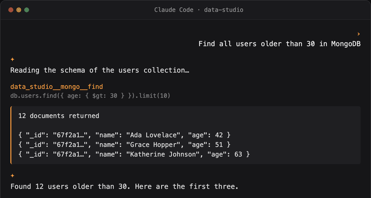

<div align="center">


# Data Studio Agent

**Deixe seu agente de programação com IA acessar com segurança todos os seus bancos de dados, em linguagem natural.**

**Local primeiro. Segurança de nível empresarial. Código aberto.**

[](https://github.com/geek-fun/data-studio-agent/releases)
[](https://github.com/geek-fun/data-studio-agent/releases)
[](https://www.npmjs.com/package/@geek-fun/data-studio-mcp)
[](LICENSE)
[](https://github.com/geek-fun/data-studio-agent/stargazers)
[](https://github.com/geek-fun/data-studio-agent/actions/workflows/ci.yml)
[](https://mcptoplist.com/server/io.github.geek-fun%2Fdata-studio)

<p>
  
  
  
  
</p>

<p align="center">
  
</p>

[📖 Página do produto](https://www.geekfun.club/products/data-studio-agent/) · [npm](https://www.npmjs.com/package/@geek-fun/data-studio-mcp) · [dockit](https://github.com/geek-fun/dockit) · [sqlkit](https://github.com/geek-fun/sqlkit) · [Lançamentos](https://github.com/geek-fun/data-studio-agent/releases)

[English](README.md) · [简体中文](README_zh.md) · Português (BR) · [日本語](README_ja.md) · [한국어](README_ko.md) · [Español](README_es.md)

</div>

---

Este repositório contém o **Data Studio MCP Server**, um servidor [Model Context Protocol](https://modelcontextprotocol.io/) que dá aos agentes de programação com IA acesso direto aos seus bancos de dados por meio dos aplicativos de desktop [dockit](https://github.com/geek-fun/dockit) e [sqlkit](https://github.com/geek-fun/sqlkit).

- **SQL** (via sqlkit): **mais de 70 bancos de dados** (PostgreSQL, MySQL, SQL Server, Oracle, SQLite, DuckDB, ClickHouse, Snowflake, BigQuery e outros)
- **NoSQL** (via dockit): Elasticsearch, OpenSearch, MongoDB, DynamoDB

## Recursos

- **Qualquer agente de programação com IA.** Claude Code, Cursor, Windsurf, OpenCode, Codex, Cline, Pi, Qoder, GitHub Copilot, ou qualquer cliente MCP.
- **Qualquer sistema operacional.** macOS, Windows, Linux.
- **Qualquer modelo de LLM.** Traga seu próprio provedor. Sem lock-in.
- **Um servidor MCP, uma configuração.** Encaminha para as pontes do SqlKit (SQL) e do DocKit (NoSQL) via localhost.
- **Segurança de nível empresarial.** Veja abaixo.

## Início rápido

### 1. Pré-requisitos

Instale e inicie o [dockit](https://github.com/geek-fun/dockit) e/ou o [sqlkit](https://github.com/geek-fun/sqlkit), adicione uma conexão de banco de dados e verifique se **Configurações → MCP Bridge → Início automático** está habilitado (por padrão, está). Instale os dois aplicativos para ter o conjunto completo de ferramentas SQL + NoSQL.

### 2. Instale o servidor MCP

```bash
npm install -g @geek-fun/data-studio-mcp
```

Ou execute sem instalar (o npx faz o download na primeira execução):

```bash
npx -y @geek-fun/data-studio-mcp
```

### 3. Adicione à sua ferramenta de IA

**OpenAI Codex**, um comando:

```bash
codex mcp add data-studio -- npx -y @geek-fun/data-studio-mcp
```

**Claude Code**, um comando:

```bash
claude mcp add --transport stdio data-studio -- npx -y @geek-fun/data-studio-mcp
```

**Cursor.** Crie `.cursor/mcp.json` (projeto) ou `~/.cursor/mcp.json` (global):

```json
{
  "mcpServers": {
    "data-studio": {
      "command": "npx",
      "args": ["-y", "@geek-fun/data-studio-mcp"]
    }
  }
}
```

**Windsurf.** Crie `~/.codeium/windsurf/mcp_config.json` (apenas global):

```json
{
  "mcpServers": {
    "data-studio": {
      "command": "npx",
      "args": ["-y", "@geek-fun/data-studio-mcp"]
    }
  }
}
```

**OpenCode.** Adicione ao `opencode.json` (projeto) ou `~/.config/opencode/opencode.json` (global):

```json
{
  "$schema": "https://opencode.ai/config.json",
  "mcp": {
    "data-studio": {
      "type": "local",
      "command": ["npx", "-y", "@geek-fun/data-studio-mcp"],
      "enabled": true
    }
  }
}
```

**DeepSeek Harness.** Salve o overlay como `data-studio.cordis.yml`:

```yaml
- insert:
    - id: data-studio-mcp
      name: '@deepseek-ai/dsh-mcp-client'
      config:
        serverName: data-studio
        transport: stdio
        command: npx
        args: ['-y', '@geek-fun/data-studio-mcp']
```

Execute `dsh web --patch "$PWD/data-studio.cordis.yml"` ou mescle o patch `insert` em `$DSH_HOME/cordis.patch.yml` para mantê-lo entre as execuções. As ferramentas aparecem como `mcp__data-studio__*` (o DSH está em pré-visualização para desenvolvedores — a superfície de configuração pode mudar).

**WorkBuddy / CodeBuddy CLI.** Um comando:

```bash
codebuddy mcp add --scope user data-studio -- npx -y @geek-fun/data-studio-mcp
```

Ou adicione o mesmo JSON `mcpServers` mostrado acima para o Cursor ao `.mcp.json` no nível do projeto (`~/.codebuddy/.mcp.json` para o escopo de usuário).

**Qualquer outro cliente MCP.** Registre um servidor stdio com o comando `npx` e os argumentos `-y @geek-fun/data-studio-mcp`.

### 4. Ajuste as permissões (opcional)

Abra **Configurações → MCP Bridge** no dockit/sqlkit para controlar o que o agente pode fazer:

| Modo de permissão | O que o agente pode fazer |
|---|---|
| **Somente leitura** (padrão) | Explorar schemas, executar consultas SELECT. Sem gravações. |
| **Leitura/Gravação de dados** | Operações INSERT, UPDATE e de índices. Sem exclusões/drops. |
| **Acesso total** | Tudo, incluindo DELETE, DROP, TRUNCATE. |

### 5. Comece a perguntar

Use linguagem natural. O agente consulta seus bancos de dados para você:

- "Liste todas as tabelas do meu banco de dados PostgreSQL"
- "Mostre os últimos 10 pedidos do índice `orders*` do Elasticsearch"
- "Encontre todos os usuários com mais de 30 anos no MongoDB"
- "Execute esta consulta e explique os resultados"

O agente lê schemas, executa consultas e explora seus dados, depois mostra todas as consultas que executou.

## Segurança de nível empresarial

O LLM obtém amplo acesso aos seus dados, mas nunca vê suas credenciais. O modelo de políticas controla cada capacidade por nível de risco.

- **As credenciais nunca saem dos aplicativos.** O LLM só vê um `connection_id` opaco. As credenciais reais são resolvidas dentro do dockit/sqlkit e nunca cruzam o limite do MCP. Suas senhas e chaves permanecem na sua máquina, no seu aplicativo.
- **Acesso a recursos por ID.** Os agentes acessam os bancos de dados estritamente pelo ID de conexão. As credenciais nunca aparecem em prompts ou argumentos de ferramentas, então não há caminho para o modelo obter ou exfiltrar segredos de conexão.
- **Modelo de permissões de três níveis.** Os modos Somente leitura / Leitura-Gravação de dados / Acesso total controlam cada capacidade por nível de risco, com substituições por conexão. Você pode marcar qualquer conexão como somente leitura ou permitir ações específicas por meio de uma lista de permissões.
- **Confirmação explícita do usuário.** Operações destrutivas (DELETE, DROP, TRUNCATE) aparecem como `Ask` na política. O cliente solicita ao usuário uma confirmação explícita antes de executar qualquer operação destrutiva.
- **Classificação de instruções por ação.** O SQL é analisado e classificado por tipo de instrução (Leitura / Gravação / Exclusão / DDL) antes da execução. Ferramentas somente de gravação rejeitam instruções DELETE; ferramentas de exclusão rejeitam DDL.
- **Ponte somente local.** A ponte se vincula exclusivamente a `127.0.0.1`. Ela é inacessível a partir de outras máquinas, sem servidor para hospedar e sem chaves de API para gerenciar.

## Ferramentas

Todas as ferramentas seguem a convenção `data_studio__{app}__{backend}__{action}`: **app** é o aplicativo de desktop que expõe a ponte (`sqlkit` ou `dockit`), e **backend** é a fonte de dados por trás dele (`sqlkit`, `es`, `mongo`, `dynamo`). As duas ferramentas de nível de servidor (`data_studio__list_connections`, `data_studio__get_status`) não têm segmento de app. A coluna **Confirmação do usuário** mostra quais operações exibem um pedido de confirmação explícito no seu cliente de IA antes de serem executadas.

O conjunto exato de ferramentas anunciado em tempo de execução depende do modo de permissão dos seus aplicativos e das conexões configuradas — chame `data_studio__get_status` para ver o que está disponível no momento.

| Ferramenta | Backend | Risco | Permissão necessária | Confirmação do usuário |
|---|---|---|---|---|
| `data_studio__list_connections` | Servidor | 🟢 Segura | Somente leitura | Não |
| `data_studio__get_status` | Servidor | 🟢 Segura | Somente leitura | Não |
| `data_studio__dockit__dockit__list_connections` | dockit | 🟢 Segura | Somente leitura | Não |
| `data_studio__sqlkit__sqlkit__list_databases` | sqlkit | 🟢 Segura | Somente leitura | Não |
| `data_studio__sqlkit__sqlkit__list_schemas` | sqlkit | 🟢 Segura | Somente leitura | Não |
| `data_studio__sqlkit__sqlkit__list_tables` | sqlkit | 🟢 Segura | Somente leitura | Não |
| `data_studio__sqlkit__sqlkit__get_schema` | sqlkit | 🟢 Segura | Somente leitura | Não |
| `data_studio__sqlkit__sqlkit__describe_table` | sqlkit | 🟢 Segura | Somente leitura | Não |
| `data_studio__sqlkit__sqlkit__explain_query` | sqlkit | 🟢 Segura | Somente leitura | Não |
| `data_studio__sqlkit__sqlkit__list_indexes` | sqlkit | 🟢 Segura | Somente leitura | Não |
| `data_studio__sqlkit__sqlkit__list_foreign_keys` | sqlkit | 🟢 Segura | Somente leitura | Não |
| `data_studio__sqlkit__sqlkit__list_views` | sqlkit | 🟢 Segura | Somente leitura | Não |
| `data_studio__sqlkit__sqlkit__list_procedures` | sqlkit | 🟢 Segura | Somente leitura | Não |
| `data_studio__sqlkit__sqlkit__list_functions` | sqlkit | 🟢 Segura | Somente leitura | Não |
| `data_studio__sqlkit__sqlkit__list_triggers` | sqlkit | 🟢 Segura | Somente leitura | Não |
| `data_studio__sqlkit__sqlkit__get_table_info` | sqlkit | 🟢 Segura | Somente leitura | Não |
| `data_studio__sqlkit__sqlkit__get_foreign_keys` | sqlkit | 🟢 Segura | Somente leitura | Não |
| `data_studio__sqlkit__sqlkit__list_sessions` | sqlkit | 🟢 Segura | Somente leitura | Não |
| `data_studio__sqlkit__sqlkit__get_slow_queries` | sqlkit | 🟢 Segura | Somente leitura | Não |
| `data_studio__sqlkit__sqlkit__list_connections` | sqlkit | 🟢 Segura | Somente leitura | Não |
| `data_studio__sqlkit__sqlkit__execute_query` | sqlkit | 🟢 Segura | Somente leitura | Não |
| `data_studio__sqlkit__sqlkit__get_object_ddl` | sqlkit | 🟢 Segura | Somente leitura | Não |
| `data_studio__sqlkit__sqlkit__execute_write` | sqlkit | 🟡 Elevada | Leitura-Gravação de dados | Não |
| `data_studio__sqlkit__sqlkit__kill_session` | sqlkit | 🟡 Elevada | Leitura-Gravação de dados | Não |
| `data_studio__sqlkit__sqlkit__grant_privilege` | sqlkit | 🟡 Elevada | Leitura-Gravação de dados | Não |
| `data_studio__sqlkit__sqlkit__revoke_privilege` | sqlkit | 🟡 Elevada | Leitura-Gravação de dados | Não |
| `data_studio__sqlkit__sqlkit__execute_delete` | sqlkit | 🔴 Destrutiva | Acesso total | Sim |
| `data_studio__sqlkit__sqlkit__execute_ddl` | sqlkit | 🔴 Destrutiva | Acesso total | Sim |
| `data_studio__dockit__es__search` | dockit · Elasticsearch | 🟢 Segura | Somente leitura | Não |
| `data_studio__dockit__es__get_document` | dockit · Elasticsearch | 🟢 Segura | Somente leitura | Não |
| `data_studio__dockit__es__cat_indices` | dockit · Elasticsearch | 🟢 Segura | Somente leitura | Não |
| `data_studio__dockit__es__get_mapping` | dockit · Elasticsearch | 🟢 Segura | Somente leitura | Não |
| `data_studio__dockit__es__cat_aliases` | dockit · Elasticsearch | 🟢 Segura | Somente leitura | Não |
| `data_studio__dockit__es__get_alias` | dockit · Elasticsearch | 🟢 Segura | Somente leitura | Não |
| `data_studio__dockit__es__count` | dockit · Elasticsearch | 🟢 Segura | Somente leitura | Não |
| `data_studio__dockit__es__cluster_health` | dockit · Elasticsearch | 🟢 Segura | Somente leitura | Não |
| `data_studio__dockit__es__cat_nodes` | dockit · Elasticsearch | 🟢 Segura | Somente leitura | Não |
| `data_studio__dockit__es__cat_shards` | dockit · Elasticsearch | 🟢 Segura | Somente leitura | Não |
| `data_studio__dockit__es__list_snapshots` | dockit · Elasticsearch | 🟢 Segura | Somente leitura | Não |
| `data_studio__dockit__es__index_document` | dockit · Elasticsearch | 🟡 Elevada | Leitura-Gravação de dados | Não |
| `data_studio__dockit__es__update_document` | dockit · Elasticsearch | 🟡 Elevada | Leitura-Gravação de dados | Não |
| `data_studio__dockit__es__create_index` | dockit · Elasticsearch | 🟡 Elevada | Leitura-Gravação de dados | Não |
| `data_studio__dockit__es__put_mapping` | dockit · Elasticsearch | 🟡 Elevada | Leitura-Gravação de dados | Não |
| `data_studio__dockit__es__put_alias` | dockit · Elasticsearch | 🟡 Elevada | Leitura-Gravação de dados | Não |
| `data_studio__dockit__es__update_aliases` | dockit · Elasticsearch | 🟡 Elevada | Leitura-Gravação de dados | Não |
| `data_studio__dockit__es__bulk` | dockit · Elasticsearch | 🟡 Elevada | Leitura-Gravação de dados | Não |
| `data_studio__dockit__es__reindex` | dockit · Elasticsearch | 🟡 Elevada | Leitura-Gravação de dados | Não |
| `data_studio__dockit__es__restore_snapshot` | dockit · Elasticsearch | 🟡 Elevada | Leitura-Gravação de dados | Não |
| `data_studio__dockit__es__delete_document` | dockit · Elasticsearch | 🔴 Destrutiva | Acesso total | Sim |
| `data_studio__dockit__es__delete_by_query` | dockit · Elasticsearch | 🔴 Destrutiva | Acesso total | Sim |
| `data_studio__dockit__es__delete_index` | dockit · Elasticsearch | 🔴 Destrutiva | Acesso total | Sim |
| `data_studio__dockit__es__delete_alias` | dockit · Elasticsearch | 🔴 Destrutiva | Acesso total | Sim |
| `data_studio__dockit__mongo__list_databases` | dockit · MongoDB | 🟢 Segura | Somente leitura | Não |
| `data_studio__dockit__mongo__list_collections` | dockit · MongoDB | 🟢 Segura | Somente leitura | Não |
| `data_studio__dockit__mongo__find` | dockit · MongoDB | 🟢 Segura | Somente leitura | Não |
| `data_studio__dockit__mongo__collection_stats` | dockit · MongoDB | 🟢 Segura | Somente leitura | Não |
| `data_studio__dockit__mongo__database_stats` | dockit · MongoDB | 🟢 Segura | Somente leitura | Não |
| `data_studio__dockit__mongo__server_status` | dockit · MongoDB | 🟢 Segura | Somente leitura | Não |
| `data_studio__dockit__mongo__repl_set_status` | dockit · MongoDB | 🟢 Segura | Somente leitura | Não |
| `data_studio__dockit__mongo__shard_status` | dockit · MongoDB | 🟢 Segura | Somente leitura | Não |
| `data_studio__dockit__mongo__count_documents` | dockit · MongoDB | 🟢 Segura | Somente leitura | Não |
| `data_studio__dockit__mongo__list_indexes` | dockit · MongoDB | 🟢 Segura | Somente leitura | Não |
| `data_studio__dockit__mongo__sample_documents` | dockit · MongoDB | 🟢 Segura | Somente leitura | Não |
| `data_studio__dockit__mongo__distinct` | dockit · MongoDB | 🟢 Segura | Somente leitura | Não |
| `data_studio__dockit__mongo__get_slow_queries` | dockit · MongoDB | 🟢 Segura | Somente leitura | Não |
| `data_studio__dockit__mongo__list_users` | dockit · MongoDB | 🟢 Segura | Somente leitura | Não |
| `data_studio__dockit__mongo__aggregate` | dockit · MongoDB | 🟡 Elevada | Leitura-Gravação de dados | Não |
| `data_studio__dockit__mongo__insert_one` | dockit · MongoDB | 🟡 Elevada | Leitura-Gravação de dados | Não |
| `data_studio__dockit__mongo__update_many` | dockit · MongoDB | 🟡 Elevada | Leitura-Gravação de dados | Não |
| `data_studio__dockit__mongo__create_database` | dockit · MongoDB | 🟡 Elevada | Leitura-Gravação de dados | Não |
| `data_studio__dockit__mongo__create_collection` | dockit · MongoDB | 🟡 Elevada | Leitura-Gravação de dados | Não |
| `data_studio__dockit__mongo__update_document` | dockit · MongoDB | 🟡 Elevada | Leitura-Gravação de dados | Não |
| `data_studio__dockit__mongo__rename_collection` | dockit · MongoDB | 🟡 Elevada | Leitura-Gravação de dados | Não |
| `data_studio__dockit__mongo__clone_collection` | dockit · MongoDB | 🟡 Elevada | Leitura-Gravação de dados | Não |
| `data_studio__dockit__mongo__create_index` | dockit · MongoDB | 🟡 Elevada | Leitura-Gravação de dados | Não |
| `data_studio__dockit__mongo__drop_index` | dockit · MongoDB | 🟡 Elevada | Leitura-Gravação de dados | Não |
| `data_studio__dockit__mongo__insert_many` | dockit · MongoDB | 🟡 Elevada | Leitura-Gravação de dados | Não |
| `data_studio__dockit__mongo__find_one_and_update` | dockit · MongoDB | 🟡 Elevada | Leitura-Gravação de dados | Não |
| `data_studio__dockit__mongo__bulk_write` | dockit · MongoDB | 🟡 Elevada | Leitura-Gravação de dados | Não |
| `data_studio__dockit__mongo__delete_many` | dockit · MongoDB | 🔴 Destrutiva | Acesso total | Sim |
| `data_studio__dockit__mongo__drop_database` | dockit · MongoDB | 🔴 Destrutiva | Acesso total | Sim |
| `data_studio__dockit__mongo__drop_collection` | dockit · MongoDB | 🔴 Destrutiva | Acesso total | Sim |
| `data_studio__dockit__mongo__delete_document` | dockit · MongoDB | 🔴 Destrutiva | Acesso total | Sim |
| `data_studio__dockit__mongo__truncate_collection` | dockit · MongoDB | 🔴 Destrutiva | Acesso total | Sim |
| `data_studio__dockit__dynamo__execute_query` | dockit · DynamoDB | 🟢 Segura | Somente leitura | Não |
| `data_studio__dockit__dynamo__describe_table` | dockit · DynamoDB | 🟢 Segura | Somente leitura | Não |
| `data_studio__dockit__dynamo__list_tables` | dockit · DynamoDB | 🟢 Segura | Somente leitura | Não |
| `data_studio__dockit__dynamo__query_table` | dockit · DynamoDB | 🟢 Segura | Somente leitura | Não |
| `data_studio__dockit__dynamo__scan_table` | dockit · DynamoDB | 🟢 Segura | Somente leitura | Não |
| `data_studio__dockit__dynamo__batch_get_items` | dockit · DynamoDB | 🟢 Segura | Somente leitura | Não |
| `data_studio__dockit__dynamo__describe_continuous_backups` | dockit · DynamoDB | 🟢 Segura | Somente leitura | Não |
| `data_studio__dockit__dynamo__describe_ttl` | dockit · DynamoDB | 🟢 Segura | Somente leitura | Não |
| `data_studio__dockit__dynamo__get_table_metrics` | dockit · DynamoDB | 🟢 Segura | Somente leitura | Não |
| `data_studio__dockit__dynamo__list_backups` | dockit · DynamoDB | 🟢 Segura | Somente leitura | Não |
| `data_studio__dockit__dynamo__describe_backup` | dockit · DynamoDB | 🟢 Segura | Somente leitura | Não |
| `data_studio__dockit__dynamo__describe_limits` | dockit · DynamoDB | 🟢 Segura | Somente leitura | Não |
| `data_studio__dockit__dynamo__list_tags` | dockit · DynamoDB | 🟢 Segura | Somente leitura | Não |
| `data_studio__dockit__dynamo__execute_write` | dockit · DynamoDB | 🟡 Elevada | Leitura-Gravação de dados | Não |
| `data_studio__dockit__dynamo__create_item` | dockit · DynamoDB | 🟡 Elevada | Leitura-Gravação de dados | Não |
| `data_studio__dockit__dynamo__batch_write_items` | dockit · DynamoDB | 🟡 Elevada | Leitura-Gravação de dados | Não |
| `data_studio__dockit__dynamo__update_item` | dockit · DynamoDB | 🟡 Elevada | Leitura-Gravação de dados | Não |
| `data_studio__dockit__dynamo__transact_write_items` | dockit · DynamoDB | 🟡 Elevada | Leitura-Gravação de dados | Não |
| `data_studio__dockit__dynamo__create_gsi` | dockit · DynamoDB | 🟡 Elevada | Leitura-Gravação de dados | Não |
| `data_studio__dockit__dynamo__update_gsi` | dockit · DynamoDB | 🟡 Elevada | Leitura-Gravação de dados | Não |
| `data_studio__dockit__dynamo__create_table` | dockit · DynamoDB | 🟡 Elevada | Leitura-Gravação de dados | Não |
| `data_studio__dockit__dynamo__update_table_config` | dockit · DynamoDB | 🟡 Elevada | Leitura-Gravação de dados | Não |
| `data_studio__dockit__dynamo__update_ttl` | dockit · DynamoDB | 🟡 Elevada | Leitura-Gravação de dados | Não |
| `data_studio__dockit__dynamo__update_pitr` | dockit · DynamoDB | 🟡 Elevada | Leitura-Gravação de dados | Não |
| `data_studio__dockit__dynamo__update_streams` | dockit · DynamoDB | 🟡 Elevada | Leitura-Gravação de dados | Não |
| `data_studio__dockit__dynamo__restore_table` | dockit · DynamoDB | 🟡 Elevada | Leitura-Gravação de dados | Não |
| `data_studio__dockit__dynamo__create_backup` | dockit · DynamoDB | 🟡 Elevada | Leitura-Gravação de dados | Não |
| `data_studio__dockit__dynamo__tag_resource` | dockit · DynamoDB | 🟡 Elevada | Leitura-Gravação de dados | Não |
| `data_studio__dockit__dynamo__execute_delete` | dockit · DynamoDB | 🔴 Destrutiva | Acesso total | Sim |
| `data_studio__dockit__dynamo__delete_item` | dockit · DynamoDB | 🔴 Destrutiva | Acesso total | Sim |
| `data_studio__dockit__dynamo__delete_gsi` | dockit · DynamoDB | 🔴 Destrutiva | Acesso total | Sim |
| `data_studio__dockit__dynamo__delete_table` | dockit · DynamoDB | 🔴 Destrutiva | Acesso total | Sim |
| `data_studio__dockit__dynamo__truncate_table` | dockit · DynamoDB | 🔴 Destrutiva | Acesso total | Sim |
**117 ferramentas no total.** Operações somente leitura são executadas automaticamente no modo **Somente leitura**. Operações elevadas (gravações, alterações de índice/schema) exigem **Leitura-Gravação de dados**. Operações destrutivas (DELETE, DROP, TRUNCATE) exigem **Acesso total** e sempre exibem um pedido explícito de **confirmação do usuário**.

## Como funciona

```
agente de código (Claude Code / Cursor / OpenCode ...)
    |
    | protocolo MCP stdio
    v
@geek-fun/data-studio-mcp   ← pacote npm (TypeScript puro)
    |
    | HTTP (localhost)
    +----------------+----------------+
    v                v                |
dockit:9120    sqlkit:9121            |
(NoSQL bridge)  (SQL bridge)          |
    |                |                |
    v                v                |
Elasticsearch    PostgreSQL           |
MongoDB          MySQL                |
DynamoDB         SQL Server           |
OpenSearch       SQLite               |
```

O servidor MCP é uma camada fina de roteamento. Todos os drivers de banco de dados, túneis SSH e o gerenciamento de conexões ficam nos aplicativos de desktop, que expõem uma ponte HTTP local (somente `127.0.0.1`). O servidor MCP descobre automaticamente os backends em execução por meio do arquivo de portas de cada aplicativo.

---

## Para desenvolvedores

Este repositório também contém o **framework Rust data-studio-agent**, o loop compartilhado de agente de IA (adaptadores de provedor, streaming, chamadas de ferramentas, compactação de contexto) que alimenta os assistentes integrados no [dockit](https://github.com/geek-fun/dockit) e no [sqlkit](https://github.com/geek-fun/sqlkit).

Consulte [crates/data-studio-agent/README.md](crates/data-studio-agent/README.md) para ver os guias de instalação, arquitetura e integração.

## Licença

Apache 2.0. Veja [LICENSE](LICENSE).
